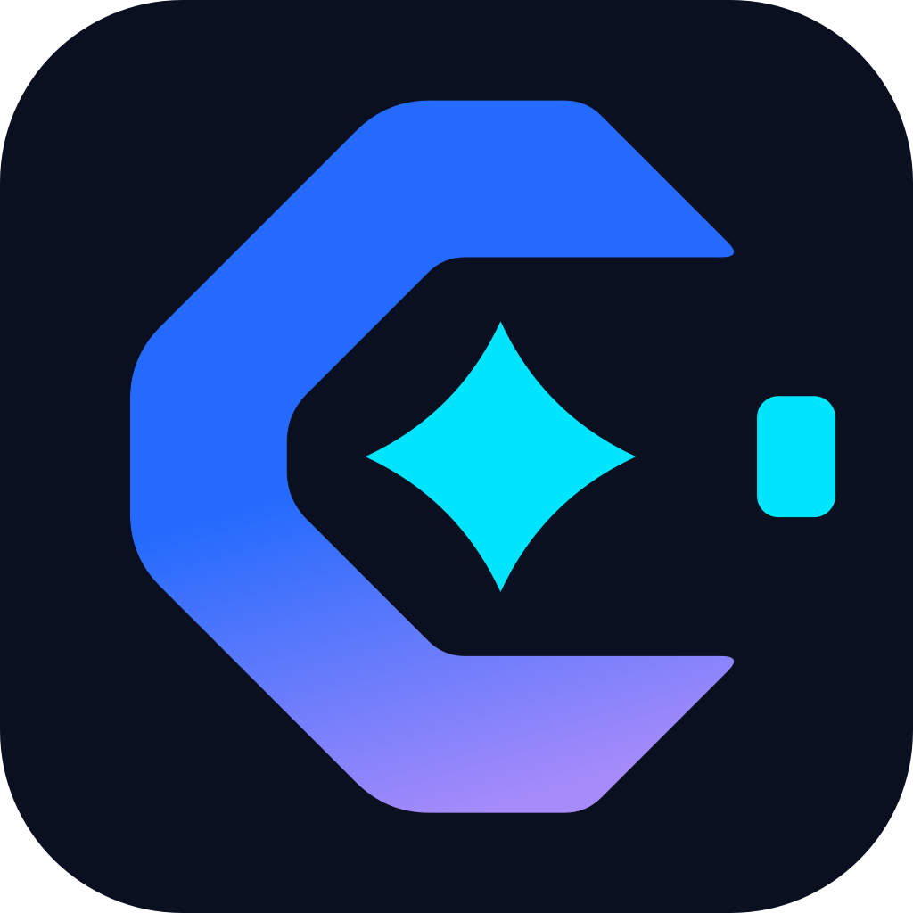
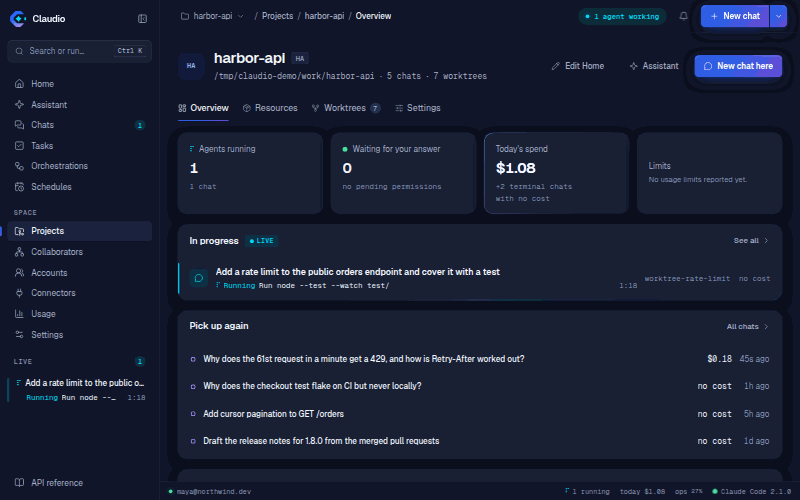
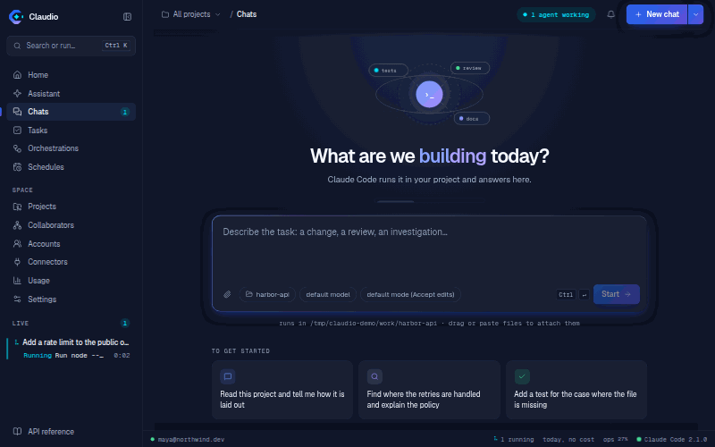
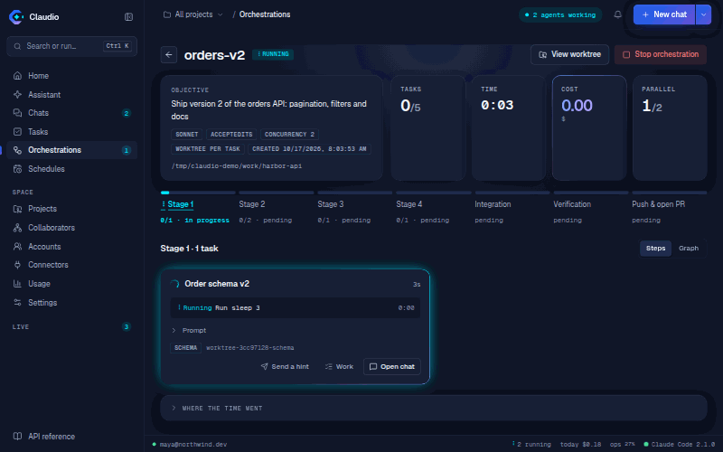
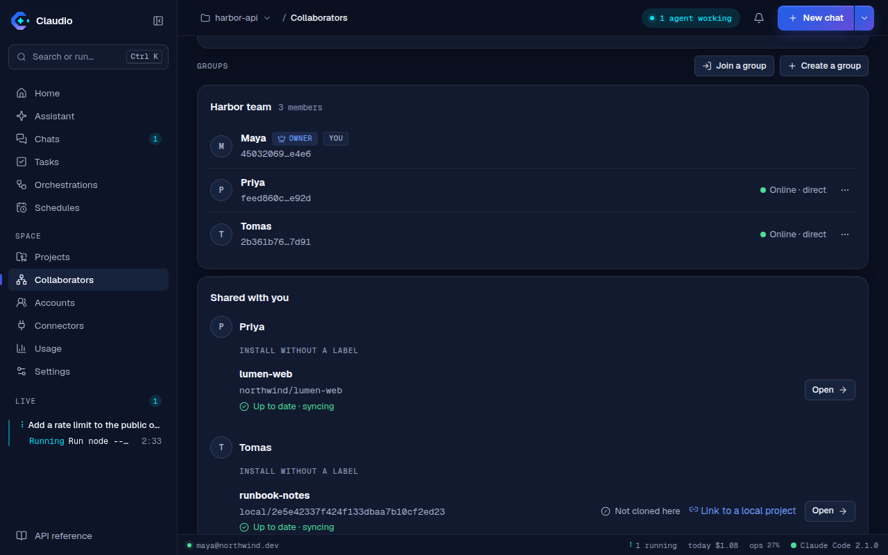
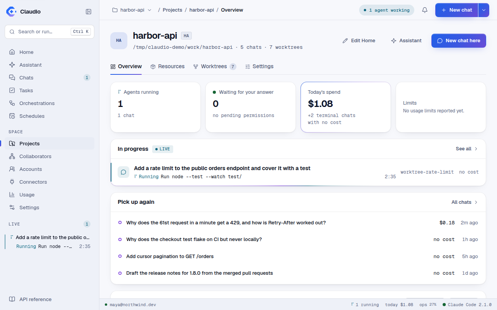

<div align="center">



# Claudio

**Run Claude Code as a service.**

[](https://github.com/yeyo11/claudio/actions/workflows/ci.yml)
[](https://github.com/yeyo11/claudio/releases/latest)
[](https://github.com/yeyo11/claudio/pkgs/container/claudio)
[](LICENSE)



</div>

Claudio puts the Claude Code CLI behind a REST API and a web UI, so you can start and watch
conversations from anywhere, run agents in parallel on a project's board, and keep going on another
Claude account when one runs out of quota. It drives Claude Code through its CLI and nothing else,
so whatever the CLI can do, Claudio can do, and nothing more.

## What it does

- **Chats, from anywhere.** Start a chat from the UI or the API, stream it, answer its permission
  prompts, questions and plans as they come, and pick up any session the CLI ever wrote.
- **Changes reviewed inside Claudio.** A diff of every chat, task and branch, with the sentence Claude
  wrote before each edit.
- **Projects and boards.** A project is created from a template, and its Tasks board holds work items
  that a chat or an orchestration works on in its own worktree.
- **A team and a flow.** Each member of a project's team is a Claude Code agent file with a role; with
  the flow on, a card entering a column starts that role's run, and only you move it to Done.
- **Orchestrations.** A graph of tasks run by parallel workers in their own worktrees, integrated,
  verified and offered as a pull request, on the graph engine or as one Claude Code workflow.
- **Several accounts, rotated.** Each Claude account signed in once; work moves to the one with
  quota left before a limit, and waits for the reset only when none has any.
- **Collaborators.** Share a project with your team, read only, peer to peer over
  [iroh](https://iroh.computer), with no server of ours. Off until you turn it on.
- **Guards and a review gate.** Hooks that hold even in `bypassPermissions` (no push, no
  `--no-verify`, no secrets written), and reviewers that can stop an orchestration before it is done.
- **The assistant.** A global chat that knows Claudio and changes things only when you allow each
  change, and a project assistant that proposes a team, resources and first tasks.
- **Schedules, cost and limits.** Chats and orchestrations on a cron, cost and usage over time, and
  a budget per run and per day.
- **Desktop app.** A Linux window over your own Claude Code login, with a tray, as a `.deb` or an
  AppImage.
- **On a phone.** An installable progressive web app with Web Push, reachable through your own
  Tailscale tailnet.
- **Docker.** One non-root image with the CLI pinned, a Compose file with a TLS profile, and a Helm
  chart.

The long version, with the screens, is [docs/features.md](docs/features.md).


<table>
<tr>
<td width="50%"></td>
<td width="50%"></td>
</tr>
<tr>
<td width="50%"></td>
<td width="50%"></td>
</tr>
</table>

<p align="center"></p>

## Install

**Desktop app (Linux x86_64).** Every [release](https://github.com/yeyo11/claudio/releases/latest)
carries a `.deb` and an AppImage. The installer takes the `.deb` through apt on Debian and Ubuntu and
the AppImage under `~/.local` everywhere else:

```bash
curl -fsSL https://raw.githubusercontent.com/yeyo11/claudio/main/scripts/install.sh | bash
```

It runs on your machine with your own `claude` and `~/.claude` login, so nothing is sandboxed and
chats start in `acceptEdits`. It updates itself from Help → **Check for updates…**. See
[docs/desktop.md](docs/desktop.md).

**Docker.** The image is `ghcr.io/yeyo11/claudio` (amd64; `latest`, a tag per release, and `edge`
from `main`):

```bash
docker run -d --init --name claudio --restart unless-stopped -p 127.0.0.1:8797:8797 \
  -v claudio-config:/home/node/.claude -v claudio-data:/data -v claudio-workspace:/workspace \
  ghcr.io/yeyo11/claudio
```

Open <http://localhost:8797>, sign in with the owner token the container printed once in its log
(`docker logs claudio`), then sign in to Claude in the setup assistant: open the link, approve and
paste the code. No Claude variable is needed. Name all three volumes, or replacing the container to
update starts again with empty ones. Compose, the TLS proxy, the Helm chart and updating (the app
can update itself in a container) are in [docs/deploy.md](docs/deploy.md).

> [!IMPORTANT]
> **A container makes an owner token on its first start; a source install or the desktop app has
> authentication off until you turn it on.** Off is right for a port bound to `127.0.0.1` and wrong
> for anything else: with `mode: none`, anyone who reaches the port can start a chat on your account
> and read every transcript on the machine. Before publishing the port, use a token or OIDC and put a
> TLS-terminating proxy in front — see [docs/securing.md](docs/securing.md).
> [SECURITY.md](SECURITY.md) spells out exactly what is and is not protected.

**From source.** Node 22+, pnpm 10 and a logged-in `claude` on your `PATH`:

```bash
git clone https://github.com/yeyo11/claudio && cd claudio
pnpm install
pnpm dev          # API on :8797, UI on :5181
```

## Quick start

1. Open Claudio: the desktop app, or <http://localhost:8797> for Docker.
2. The setup assistant says whether Claude Code is found and signed in, and signs in what is missing.
3. **New chat**: pick a directory, write a prompt, and watch it work. When it asks for permission,
   answer from the panel.
4. Import the directory as a project to get its dashboard, its Tasks board and its team.
5. Add another Claude account in **Accounts** to rotate between them at a limit.

The interactive API reference is at `/docs` on the same port, and the OpenAPI 3.1 document at
`/openapi.json`.

## Documentation

| | |
| --- | --- |
| [Features](docs/features.md) | Everything Claudio does, at length, with the screens |
| [The UI](docs/ui.md) | Every page, the keyboard shortcuts, notifications and live updates |
| [How it talks to Claude Code](docs/cli-surfaces.md) | Every CLI surface in use: the one rule, as a table |
| [REST API](docs/rest-api.md) | Every route, grouped by tag |
| [Configuration](docs/configuration.md) | The environment variables |
| [Deploying](docs/deploy.md) | Docker, Compose, TLS, Helm, the volumes, updating and restarts |
| [Securing an install](docs/securing.md) | Authentication, the host allowlist, guards, the proxy |
| [Desktop app](docs/desktop.md) | Installing, the tray, updates and building from source |
| [On a phone](docs/pwa.md) | Installing the web app and Web Push |
| [Accounts](docs/accounts.md) · [Orchestrations](docs/orchestrations.md) · [Team and flow](docs/team-and-flow.md) · [Collaborators](docs/collaborators.md) · [Guards](docs/guards.md) | The main features, one page each |
| [Known limitations](docs/known-limitations.md) | What it does not do, and why |
| [Where the project stands](docs/status.md) · [Roadmap](ROADMAP.md) | What is built, what is open, what was refused |
| [Developing Claudio](docs/development.md) | Local development, the browser suite, the media, the monorepo |

`docs/` is the project's knowledge base: every feature and decision has a page there
([docs/knowledge-base.md](docs/knowledge-base.md)).

## Contributing

Bug reports, ideas and pull requests are welcome. [CONTRIBUTING.md](CONTRIBUTING.md) covers the
setup, the checks CI runs and the one architectural rule worth knowing before you write code:
Claudio reaches Claude Code only through the interface Anthropic ships for programs, its CLI.
Releases are cut by release-please from Conventional Commits.

Vulnerabilities go through [private advisories](SECURITY.md), not public issues.

## Support

If Claudio saves you time, you can [buy me a coffee](https://buymeacoffee.com/yeyo11). Starring the
repo helps just as much.

## License

[MIT](LICENSE) © Jose Antonio Garrido

Claudio is an independent project. It drives the Claude Code CLI and is not affiliated with,
endorsed by or sponsored by Anthropic.
