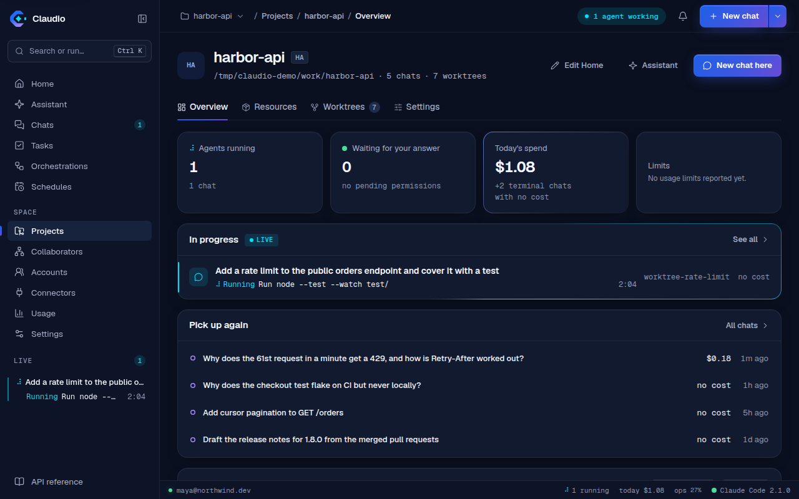
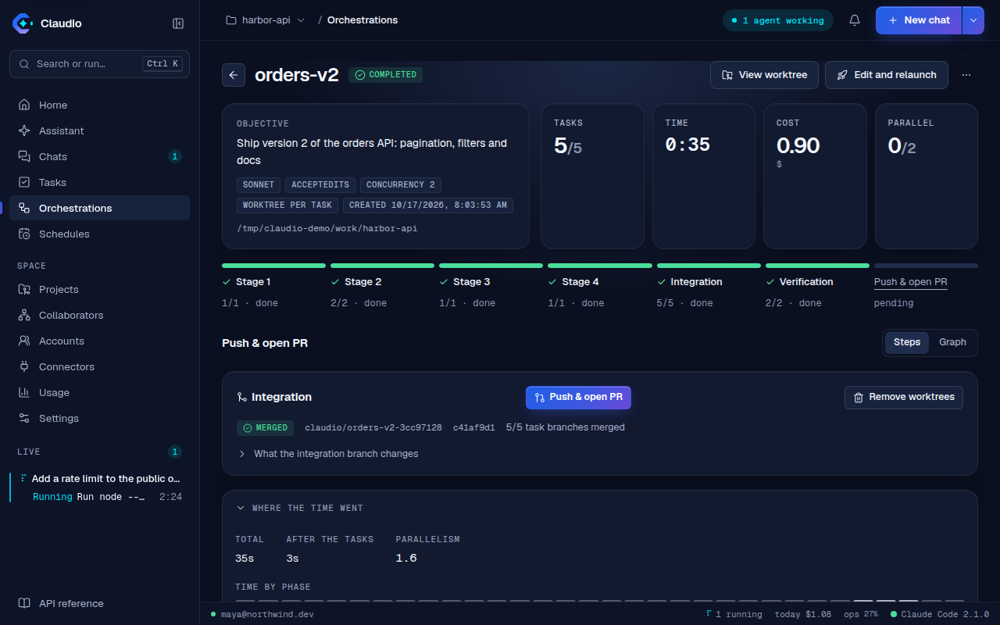
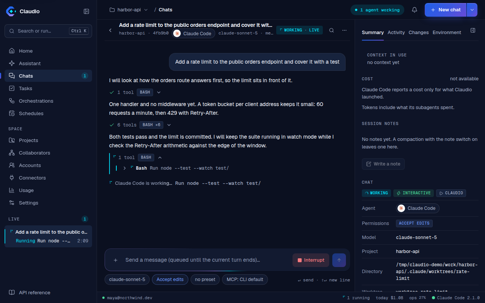
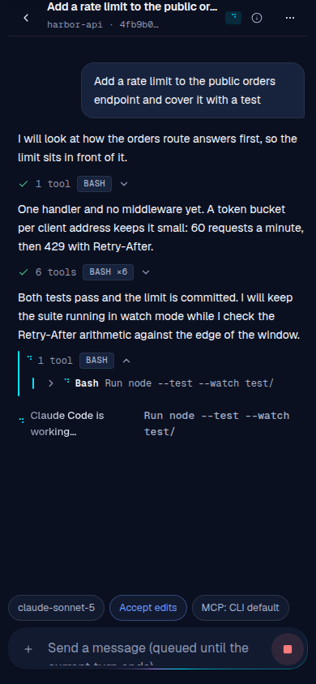
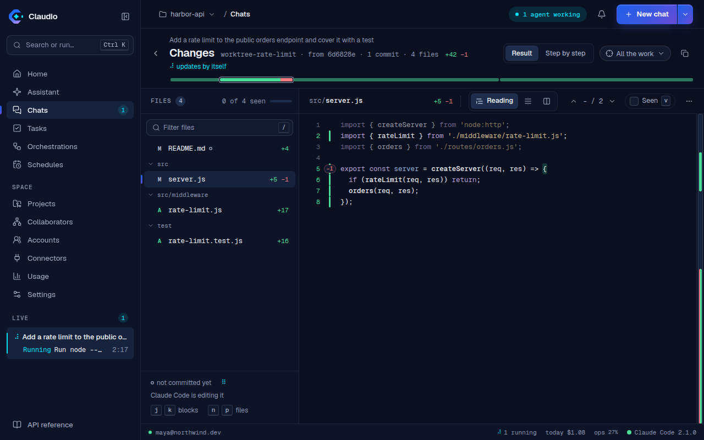
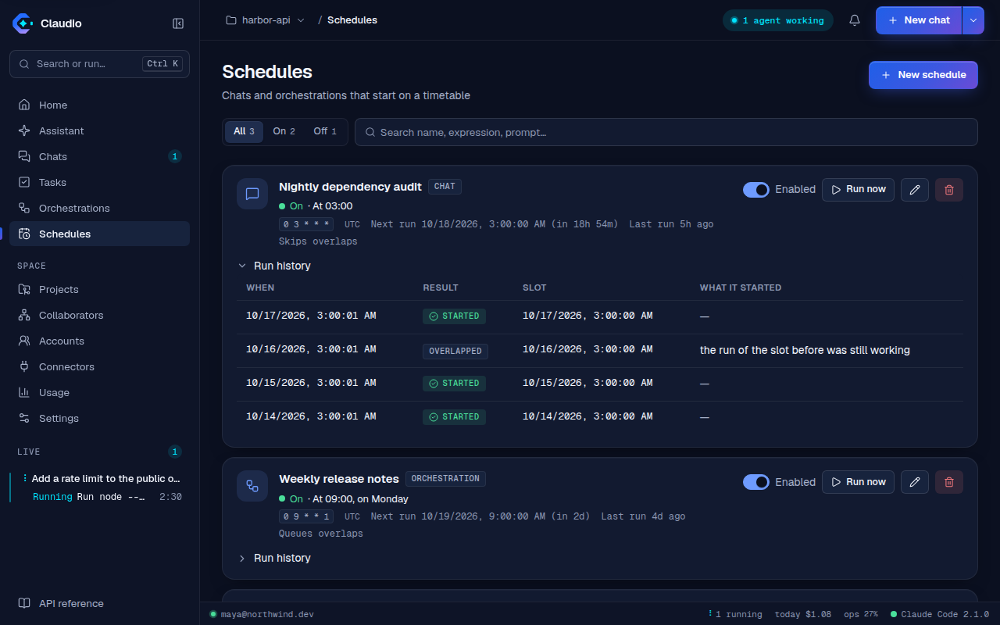

# What Claudio does

The long version of the README's feature list: each feature in a paragraph, with the page that
describes it. Until 2026-10-17 this list and the screenshots below were the README's "What you
get".

Claude Code lives in your terminal. One machine, one session at a time, and nothing to look at
once you close the tab.

Claudio puts it behind a REST API and a web UI: start and watch conversations from anywhere, run a
graph of agents in parallel, browse every transcript the CLI has ever written, and go on with another
Claude account when one runs out of quota — without giving up a single thing the CLI can do, because
Claudio drives it through the CLI and nothing else.

## Features

- **Every conversation, from anywhere** — start a chat from the UI or the API, stream the tokens,
  answer follow-up turns, and pick up any session the CLI has ever written on that machine.
- **Answer what Claude asks, as it asks** — a headless chat has nobody to ask, so it is normally
  denied anything that needs permission. Claudio speaks the CLI's control protocol
  (`--permission-prompt-tool stdio`) and routes every prompt to the panel: tool calls with the exact
  command (allow, allow always, or deny with a reason the model reads), questions from
  `AskUserQuestion` with their options, and plans to approve or send back. From the same screen you
  interrupt a turn without losing the session and switch the permission mode or the model mid-run.
- **Orchestration** — a DAG of tasks, each with its own Claude worker, run in parallel with
  dependency context and a synthesis step. Every worker can get its own git worktree and branch,
  so parallel agents never write over each other. An auto-planner drafts the graph; plans are kept,
  so one lost to a closed tab is reloaded instead of paid for twice, and a graph interrupted by a
  restart goes on where it stopped.
- **Several Claude accounts, rotated** — each account its own `CLAUDE_CONFIG_DIR`, signed in once
  with `claude auth login` (or a setup token or an API key); usage per window, proactive switching
  before an account runs out, and a turn that hits its limit replayed in the same chat on the next
  account (a chat pinned to an account rotates only within its policy). Every rotation is
  recorded, so "why did my account change" has an answer that survives a restart. See
  [accounts.md](accounts.md).
- **See what an agent really did, and step in** — for every orchestration task and every chat: the
  branch and its commits, the files changed with `+/−`, what is uncommitted, the worker's own checklist, and what it is running right now. A health badge notices
  a hung or repeated command, a chat busy without progress, a loop, a test bent to pass, silence and
  a blown budget, says why in one line and offers three ways in: cancel just that command's process
  tree, send a hint, interrupt. An optional supervisor — Haiku, off by default — wakes once per
  signal when a worker turns `bad`, reads its last steps and proposes the hint, for you to send,
  edit or dismiss.
- **Tool calls that read as what happened, and what is running at a glance** — an opened `Edit`, `Read` or `Bash` shows its diff, numbered file or output instead of JSON, and a folded strip above the composer lists every running subagent, background command and workflow with what each is doing.
- **Review the changes without leaving Claudio** — one screen for a chat, a task or the integration
  branch, drawn by a diff comparator of its own (no editor, no diff library). **Reading**, the
  default, shows each file as it is now with a 3 px rail on what is new and what was removed folded
  into a pill; **Unified** and **Side by side** are one key away. Syntax stays muted so only the
  change carries colour, a changed phrase is one mark, and a change fingerprint, a file map (seen,
  not committed, being edited now) and a block rail with `j`/`k`/`n`/`p` keep a long branch
  navigable. The **Step by step** lens replays every edit from the transcript with its own patch and
  the sentence Claude wrote just before it, one click from that place in the conversation, so a chat
  outside a repository can be reviewed too.
- **Verify once, after integrating** — an orchestration can run its checks (build, the browser
  suite) once on the merged branch, after an install step it works out from the lockfile, with a
  fixer agent held to rules Claudio writes and a cap on its attempts and on what it may spend.
  Workers only run the type check and the unit tests; the outcome is on the graph before a pull
  request is offered, and it can fail the graph outright if you ask it to.
- **Orchestration you can revise** — re-run one task of a finished graph with everything that
  depends on it, edit and relaunch a graph as a new one, save graphs as templates, and give a task
  or the whole graph a time and a cost limit.
- **A board of what each project needs done** — a project is created from one of five templates in
  a wizard, and switches its modules on and off in its settings. The Board module gives it a Tasks
  board:
  - work items with YouTrack-style keys (`AGN-12`);
  - five fixed columns with optional limits, dragged by pointer or keyboard;
  - epics, and milestones without dates;
  - acceptance checklists, `blocks` relations, comments and a history the server writes;
  - a list view, and an All projects view.

  "Work on it" starts a chat on an item in its own worktree on `claudio-task/<key>`. A selection becomes a
  draft orchestration with its dependencies. A chat's message becomes a task. The item then moves
  itself as that work goes, forward only and never over a person's move, and its card shows live
  while an agent works on it. See [docs/projects.md](projects.md) and
  [docs/work-items.md](work-items.md).
- **A team of agents that works the board** — with the Team module on, a project has members, each a
  Claude Code agent file in `.claude/agents/` (so it works from a terminal too) with a role, a model
  and the paths it may write. Switch the **flow by column** on and a card entering a column starts
  its role's run as that agent:
  - the Product Owner refines in Backlog and To do;
  - the Developer implements in In progress;
  - QA verifies in In review, and sends the card back with its comment a set number of times before
    it waits for you.

  Agents move cards, but only you move one to Done, and at most a set number of runs go at once.
  Members propose what the team should remember, and nothing reaches `CLAUDE.md`, the CLI's memory
  or the project **journal** until you approve it. Every run is handed the journal's newest entries.
  **Documents** reads and edits the repository's documents folder, with the specifications and
  decisions a run wrote tied to their task. See [docs/team-and-flow.md](team-and-flow.md).
- **An assistant that reads the project and proposes what to create** — a read-only Claude Code chat
  (`Read`, `Grep`, `Glob`, `LS`, and `git log`/`git status`/`ls`) that answers through
  `--json-schema`. It proposes a team, agents, skills and commands, and first tasks, each with the
  reason it is proposed, and keeps the list of what it read. You accept or discard each proposal on
  its own, and nothing is written until you accept it: a member through the team, a task in
  Backlog, a resource opened in the editor unsaved. It runs when you create a project, from the
  board ("Suggest tasks") and from a project's resources ("Suggest", "Create with AI"), never on a
  schedule, and shows its model, time and cost like any chat. See [docs/assistant.md](assistant.md).
- **Tools and servers per chat** — start or resume a chat with a named preset of allowed and
  disallowed tools (`read-only`, `no-network`, `everything`, all editable, restorable, one of them
  the default for a chat that picks none) and with only the MCP servers you pick. A fork inherits
  its source's tools, and a resume picks up a server you edited since.
- **Recurring work** — chats and orchestrations on a cron expression and a time zone, with a run
  history and a say in what happens when a slot arrives while the last run is still going (start
  anyway, skip it, or queue it). A window missed while Claudio was down is skipped, never run late.
- **Cost and usage over time** — per day or week, per project and per model, from the cost the CLI
  reports, over any range you pick from a calendar; any transcript, or a whole project's chats,
  exported as Markdown or JSON.
- **Spending limits** — cap any run with a budget the CLI enforces from inside.
- **Guards on tool calls** — deterministic hooks that hold even in `bypassPermissions`: no `--no-verify`, no
  push from a worker, no `rm -rf` outside the worktree, no secrets in a command. On for orchestration
  workers and the flow, opt-in for chats. Defence in depth, not a sandbox: see [docs/guards.md](guards.md).
- **A review that fails closed** — an orchestration can have reviewers per dimension and a verifier look at
  the integrated diff before it is done; only a confirmed blocking finding stops it, and only a person can
  accept it anyway. See [docs/orchestrations.md](orchestrations.md#the-review-gate).
- **Lessons from corrections** — "no, use pnpm" becomes a proposed lesson with its evidence; a person
  approves it, and then the project's chats and workers are handed it. See [docs/lessons.md](lessons.md).
- **Instruction evals** — measure whether an agent file, a skill, a rule or `CLAUDE.md` is followed, before
  and after a change, at several levels of pressure. See [docs/evals.md](evals.md).
- **A limit does not stop the work** — each account shows how much of its usage limit is spent; at
  a limit the turn moves to another account with quota and is replayed there, and when no account
  has any, the work waits for the reset (a person's chat offers the wait).
- **claude.ai connectors** — the Docs, Gmail and Calendar connectors the CLI can see, their status
  and prepared prompts that start a chat.
- **The whole configuration surface** — settings, instructions, MCP servers, agents, skills,
  commands, output styles, memory, plugins and marketplaces, per user and per project.
- **Safe to expose** — token or OIDC authentication in front of every route, a read-only mode, secrets
  in MCP `env` and `headers` never returned by the API, an audit log of every write you can narrow by
  path, method and status, and a way back in from the environment when the token is lost. See
  [securing.md](securing.md).
- **On your phone** — installable to a home screen on Android and iPhone as a progressive web app,
  and able to tell you that a chat is waiting while it is closed, over Web Push this server signs
  with its own VAPID key. No app store, no native shell, no third-party push account. The
  push half needs HTTPS: see [pwa.md](pwa.md).
- **Reach it from your phone, through your own tailnet** — Settings → Remote access serves this
  Claudio on your [Tailscale](https://tailscale.com) tailnet with `tailscale serve` (never Funnel), at
  a stable HTTPS address with a QR code for the phone: no domain, no proxy, nothing on the public
  internet. It only opens while authentication is on, only the node's exact name is let in, and only
  the one Serve rule Claudio added is ever removed. See [docs/tunnel.md](tunnel.md).
- **Share a project with your team, read only** — the Collaborators page connects your Claudio to your
  teammates' directly, peer to peer over [iroh](https://iroh.computer), with no server of ours. A
  project shared with a group shows up in each member's Claudio as a live, read-only copy of its
  chats, memory, documents and board, and nobody's quota is spent. Off until you turn it on. See
  [docs/collaborators.md](collaborators.md).
- **One container, one volume** — non-root, the CLI baked in and pinned with an update check,
  everything else on a data volume. Compose profiles, a TLS proxy and a Helm chart are in
  [docs/deploy.md](deploy.md).

## Screens

### A project's dashboard: what is working now, and what to pick up

### A board of what the project needs done, and who is working on it

### Workers in parallel, then one branch that was checked

### See what an agent really did, and step in

### Review the changes without an editor

### Work that comes back every night

## Related

[[ui.md]] · [[cli-surfaces.md]] · [[orchestrations.md]] · [[accounts.md]] · [[team-and-flow.md]] · [[work-items.md]] · [[collaborators.md]] · [[guards.md]] · [[assistant.md]] · [[claudio-assistant.md]] · [[desktop.md]] · [[pwa.md]] · [[deploy.md]]
