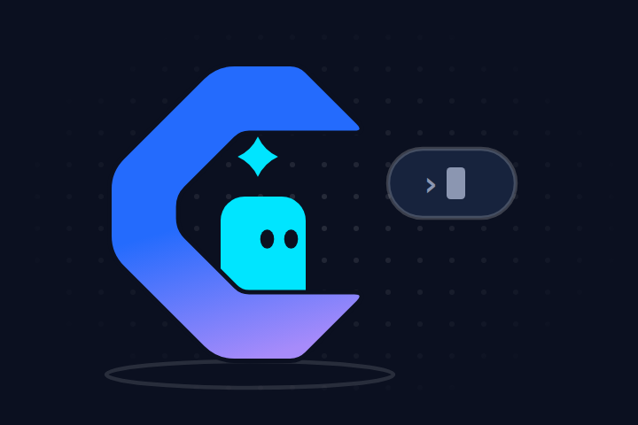
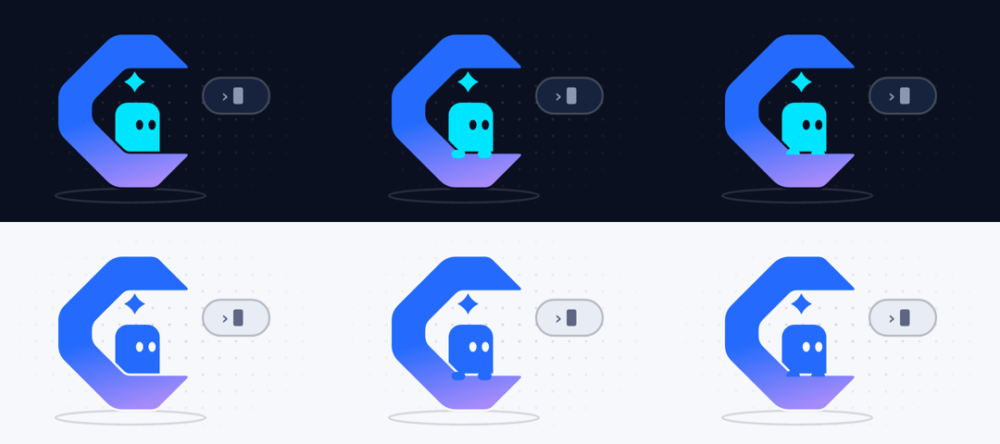
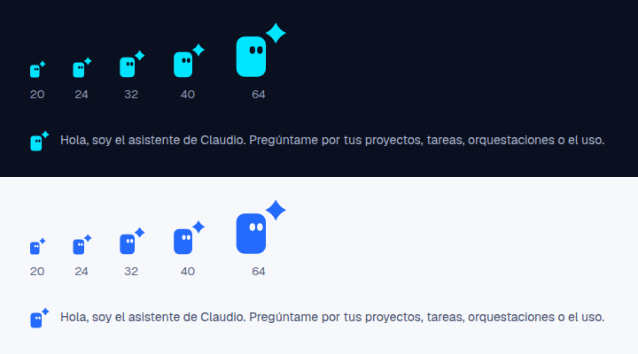
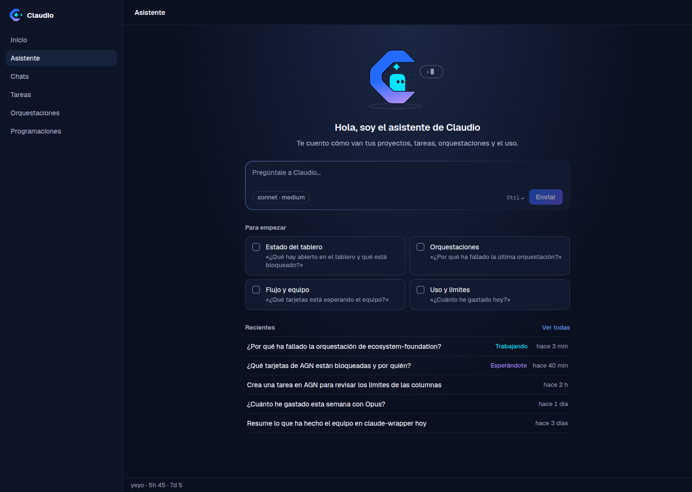
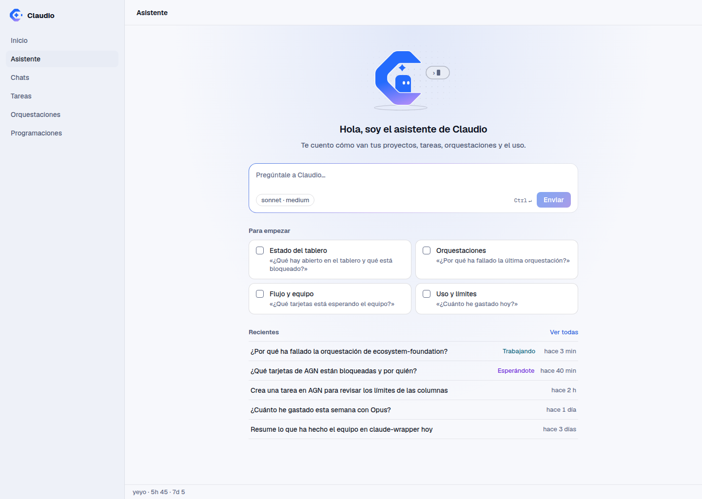
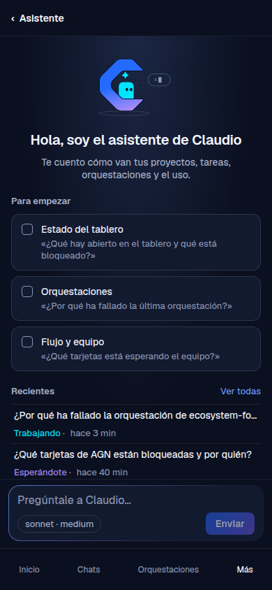
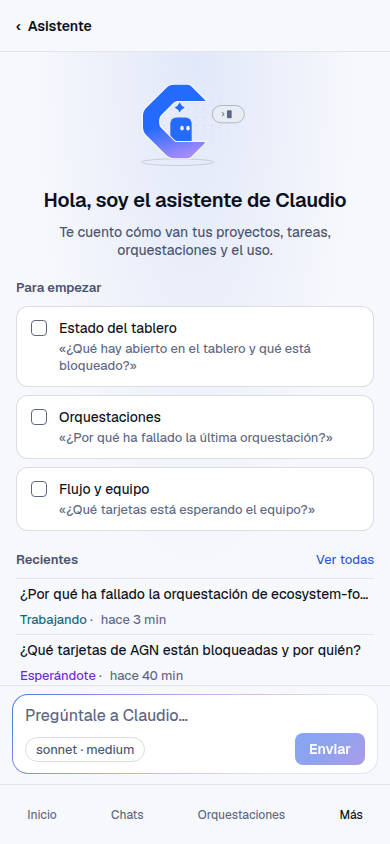

# Plan: the assistant's mascot and its recent conversations

Status: **designed, not built** (2026-10-19). The owner chose the three decisions below on
2026-10-19. This plan settles the design: the drawing, the page, the copy, the amendments to the
design system and the contract. The work is one pull request on `feat/assistant-mascot`, built by
the orchestration in [Tasks](#tasks). Workers run on `claude-sonnet-5-5` and the review on
`claude-opus-5-5`, never fable. Workers never run the e2e suite: CI runs it (`pnpm e2e:remote`, the
`e2e-on-github` skill).

This plan is the source of truth for that orchestration, together with CLAUDE.md and
CONTRIBUTING.md. Where a task prompt and this plan disagree, the plan wins. The drawings are already
committed as reference SVGs. A worker ports them; it does not redraw them.




## Context

Each fact below was re-read at `671350a4d` (main, 2026-10-19).

### The entry today

- `/assistant` is `ClaudioAssistant` in `apps/web/src/pages/claudio-assistant/Entry.tsx:32-118`. The
  order is `Hello` (`:84`), then the composer on a desktop (`:86`), then `.as-starters-section`
  (`:87-110`). On a phone the composer sits at the foot (`:114`).
- `Hello` (`:155-182`) draws `AssistantMark` (the lucide `Sparkle` on a neutral 40 px tile,
  `apps/web/src/components/assistant/run.tsx:23-29`), the title, one line, and the live figures:
  chats working and orchestrations running in `--live`, and today's cost. These come from
  `useOverview()` and `useUsageNow()`. The styles are in `apps/web/src/styles/claudio-assistant.css:21-71`.
- `AssistantMark` is shared. It is drawn by the Claudio assistant's chat greeting
  (`pages/claudio-assistant/Greeting.tsx:12`) and also by the **project** assistant's runs
  (`pages/assistant/cards.tsx:75,225`, `pages/home/resources/parts.tsx:167`), where a live run turns
  it cyan (`styles/suggestion.css:39-43`).
- The sidebar item and the Más row take `Sparkle` as a `NavItem` icon (`apps/web/src/App.tsx:248`).
  The palette uses it too (`components/CommandPalette.tsx:173`).
- The composer is New chat's `StartComposer`. Its card is `form.composer.new-composer.grad-border`
  and its start button is `.btn.btn-primary.new-start`
  (`packages/chat-ui/src/composer/Composer.tsx:573`). That makes **two gradient surfaces already**:
  the card's hairline and Enviar. `docs/design-system.md:1664` still says "one gradient surface, the
  send button", which is out of date since the 2026-10-17 switch to New chat's box.
- `e2e/specs/assistant.spec.mjs:75-100` checks `.as-hello` < the composer < `.as-starters-section`,
  `.live-energy` count 0 and the `grad-border` card. `apps/web/test/claudio-assistant.test.tsx:65`
  checks the same order in markup.

### The rules this changes

- `docs/design-system.md:1659`: "The entry screen is content, not an `Empty`." The live figures are
  part of that bullet.
- `docs/design-system.md:2103-2105` (§4): an illustration appears at most once per screen, never next
  to live data, and never as decorative filler on a page that has content.
- `docs/claudio-assistant.md:50`: "there is no illustration".
- The design system counts a drawn logo as a gradient surface (`docs/design-system.md:1901`, the
  setup assistant). New chat already draws `welcome` (one `f-grad` element and a halo) beside a
  `.grad-text` hero, the `grad-border` card and its primary (`apps/web/src/pages/NewChat.tsx:210-212`).

### The logo and its tokens

- The source is `docs/design-system/claudio-brand-kit/logos/svg/claudio-symbol.svg`: the open C (gradient
  `#246BFD` → `#A78BFA`, `x1 .35 y1 0 x2 .6 y2 1`, a stop at .5), the four-point spark at its centre,
  and the prompt block `rect x98 y51.5 11×17 rx3` at its mouth.
- In the app it is `BrandMark` (`packages/ui/src/components/icons.tsx:34-54`), coloured by
  `.logo-mark .logo-stop-a/-b/.logo-spark` (`packages/ui/src/styles/primitives.css:721-731`).
- The tokens are `--logo-blue`, `--logo-violet` and `--logo-spark` (`packages/ui/src/styles/tokens.css:46-48`).
  `--logo-spark` turns `#246bfd` in light (`:293`, and `:375` for `system`). The token comment says the
  spark is "the one static cyan in the app".
- The brand guide (`docs/design-system/claudio-brand-kit/docs/BRAND-GUIDE.md`) forbids stretching or
  rotating the mark, adding outlines to it, and relying on glow or 3D effects.

### Illustrations

- `Illustration` (`packages/ui/src/components/illustrations/Illustration.tsx`) draws the frame, one
  gradient (`--il-grad`, `--accent` → `--accent-2nd`), the dot pattern and the fade mask, all with
  `useId()` ids. Then it draws the drawing. The catalogue is the `ILLUSTRATIONS` map. Colour comes
  only from classes in `packages/ui/src/styles/illustrations.css`. Every loop stops under
  `data-motion='subtle' | 'off'` and `prefers-reduced-motion`, and `motion.css` pauses them in a
  hidden tab.
- `apps/web/test/illustrations.test.tsx:16` asserts 17 drawings, and `:35` asserts 12 ids for three
  instances (four defs each).

### Chats and the assistant marker

- An assistant chat carries `claudioAssistant: ClaudioAssistantMarker` on `Chat`
  (`packages/shared/src/types.ts:1366,1382-1387`). `ChatSummary` keeps it (`:1418`). The core sets it
  from the runtime record (`packages/core/src/chat-service.ts:435`).
- `GET /chats` (`apps/api/src/routes/chats.ts:93-104`) filters by `project`, `loose`, `origin`,
  `workers`, `state` and `limit`. It has no assistant filter. The core's `ChatFilter`
  (`chat-service.ts:241-253`) and `list()` (`:462-483`) skip a chat before assembling it, which is
  cheap. The web calls it through `api.chats` (`apps/web/src/api.ts:600-611`). The route is documented
  in `apps/api/src/openapi/routes.ts:328` and has a row in `docs/rest-api.md:550`.
- An assistant chat runs in its project's directory when it has one (`packages/core/src/index.ts:2063`),
  so the Chats page's project scope can hide some of them.
- The Chats page reads its filters from the address (`LIST_PARAMS`, `apps/web/src/pages/Chats.tsx:68`)
  through `ChatFilters` (`packages/chat-ui/src/lib/chat-model.ts:103-115`). Its state word is
  `StateWord` (`Chats.tsx:106-116`): working in `--live`, waiting in `--idle`, a bad outcome as a badge,
  and idle said to screen readers only. The words are `STATE_LABEL` (`chat-model.ts:44`):
  "Trabajando", "Esperándote", "Inactivo".

### The reference screens are stale

`docs/design-system/reference/screenshots/DesktopAsistenteClaudio-*.webp` and
`MobileAsistenteClaudio-*.webp` still show "Agentry" in the sidebar and the title, the live figures
in mono, and uppercase section labels. They were drawn by
`docs/design-system/reference/tools/assistant_entry.py`. The HTML no longer says Agentry, but the
screenshots were never regenerated.

## Decisions

### D1. Cursor, a character derived from the logo

The logo's prompt block becomes a small character. The owner named it **Cursor**. It is a rounded
block in `--logo-spark` with the logo block's proportions (11 : 17, corner radius about a third of
its width) and two dot eyes. It peeks over the lower arm of the open C, which is its doorway. The
four-point spark floats above its head as "the idea", inside the C, where the logo keeps it. A small
prompt card (`›` and a blinking caret) floats outside the mouth: it is about to answer.

The C itself is the logo's own path, scaled uniformly by 1.1. It is not stretched, rotated, outlined
or given a glow, and it keeps the logo's gradient (`--logo-blue` → `--logo-violet`, the kit's
direction and stops). The gradient is on the C alone. The character, the spark and the card are flat.
The drawing has **no `.halo`**.

Rejected options, drawn in `assistant-mascot/variants-hands.png`:
- Hands gripping the arm's edge. They read as feet or glasses at 160 px, and their outlines break up
  the arm.
- A half-moon variant. It disappears into the arm in light.

The plain peek (variant A) reads at every size.



"Cursor" is the character's name in docs and design talk. **No UI copy says it in this plan**, for two
reasons: the greeting stays "Hola, soy el asistente de Claudio", and "Cursor" is also the name of a
well-known AI code editor (see [Open questions](#open-questions)). In code the drawing is
`assistant` and the mark is `AssistantMascot`.

### D2. The mascot is always on `/assistant`, and the live figures go

The illustration replaces the sparkle tile in `Hello`. It shows in every state of the page: no
history, some history, loading, error. Chats working, orchestrations running and today's cost leave
the greeting. The Home page, the status bar and the sidebar's live group already say them. The
design system is amended (see [The design-system amendments](#the-design-system-amendments)).

### D3. Recent assistant conversations under the starters

A "Recientes" list shows 5 rows on a desktop and 3 on a phone. Each row has the title (the first
prompt), the state as a word, and the time since its last activity. Under the list, **Ver todas**
opens the Chats page filtered to the assistant's chats. It is fed by a new filter,
`GET /chats?assistant=1`.

### D4. The compact mark is the assistant's own, not the project assistant's

`assistant-mark.svg` (the block, its eyes and the spark, without the C) replaces `AssistantMark` in
**the Claudio assistant's chat greeting** (`Greeting.tsx`). The project assistant's runs keep the
sparkle tile, because the two are different features (`docs/assistant.md`) and a live run turns that
tile cyan, which the always-cyan mascot could not show. The sidebar item, the Más row and the palette
keep the lucide `Sparkle`: they are 16 px stroke icons in a family of stroke icons, and the mark needs
20 px at least. Both choices are open questions for the owner.

### D5. The gradient budget on `/assistant`

The page has three brand-gradient elements: the composer's `grad-border` hairline and Enviar (one
card and its primary, the pair §2 allows, `design-system.md:492`), and the C of the drawing. As on New
chat with `welcome`, **an illustration's one gradient element belongs to the drawing** and is not one
of the screen's two surfaces. It never takes a halo, and the page then has no `.grad-text`. §4 writes
this down (amendment 3 below), because New chat already relied on it without saying so. The
alternative is in [Open questions](#open-questions).

## Design

### The illustration `assistant` (240 × 160)

Reference: `docs/design-system/illustrations/assistant.svg`. It follows the other reference SVGs:
its own `<style>` with dark fallbacks, the shared defs, and the faded dot backdrop.

| Element | Geometry (user units) | Class | Colour |
|---|---|---|---|
| ground | ellipse `cx94 cy141 rx54 ry5` | `ln-soft` | `--line-2` |
| body | rect `x83 y74 32×54 rx9`, inside `g.a-float` | `f-spark` (new) | `--logo-spark` |
| eyes | ellipses `cx100.5/109.5 cy90 rx2.6 ry3.6`, inside `g.a-look` (new) | `f-eye` (new) | `--bg` |
| the C | the logo's path, `transform="translate(31 14) scale(1.1)"`, drawn **after** the body so its lower arm hides the body's foot | `f-logo cut` (new) | the logo gradient, with a 3-unit `--bg` stroke under the fill (`paint-order: stroke`) that separates it from the body |
| spark | the logo's spark recentred, `translate(97 59) scale(.4)`, in `g.a-float-2` | `f-spark` | `--logo-spark` |
| prompt card | rect `x146 y56 48×26 rx13`, `›` and a caret rect `x168 y63 7×12`, in `g.a-float-2` | `c2`, `txt-big`, `f-ink a-blink` | `--bg-3`, `--line-3`, `--fg-3` |

New classes for `styles/illustrations.css`, and the same in `claudio-ds.css` §14:

```css
.il .f-spark { fill: var(--logo-spark); }
.il .f-eye { fill: var(--bg); }
.il .f-logo { fill: var(--il-logo); }
.il .cut { stroke: var(--bg); stroke-width: 3; stroke-linejoin: round; paint-order: stroke; }
.il .stop-logo-a { stop-color: var(--logo-blue); }
.il .stop-logo-b { stop-color: var(--logo-violet); }
.il .a-look { transform-box: fill-box; transform-origin: center; animation: il-look var(--il-look-cycle) ease-in-out infinite; }
@keyframes il-look { 0%, 92%, 100% { transform: scaleY(1); } 95% { transform: scaleY(0.12); } }
```

- `Illustration.tsx` gains a fifth def, `${id}-logo`: a `linearGradient x1 .35 y1 0 x2 .6 y2 1`
  with stops at 0 and .5 (`stop-logo-a`) and 1 (`stop-logo-b`). `--il-logo: url(#${id}-logo)` joins
  `--il-grad` and `--il-dots` on the root's style. Every drawing gets it, so the id test goes from
  12 to 15.
- `--il-look-cycle: 6000ms` joins the `--il-*-cycle` tokens (`tokens.css:183-189`).
- `.cut` and `.f-eye` paint with the page's `--bg`. The drawing belongs on the page's own background,
  never on a raised card: there the cut would show as a ring.
- In light, `--logo-spark` is the same blue as the top of the C. The `.cut` gap is what tells them
  apart, so it is not optional.

**Motion** (only under `data-motion='full'`; the existing `.il *` rules already stop all of it under
`subtle`, `off`, `prefers-reduced-motion` and in a hidden tab):
- the body bobs 4 px (`a-float`, 4.8 s), which looks like peeking over the arm;
- the spark and the card float out of phase (`a-float-2`);
- the caret blinks (`a-blink`);
- the eyes blink once every 6 s (`a-look`).

Nothing pulses, and nothing uses `--live`. `motion.spec.mjs` covers it because it is an `.il`.

### The mark `AssistantMascot` (24 × 24)

Reference: `docs/design-system/illustrations/assistant-mark.svg`. It is a body (`x2.5 y6.5 12.5×17
rx3.5`), two eyes looking up at the spark, and a spark at `(19.2, 5)`. A component
`AssistantMascot({ size = 24 })` goes in `packages/ui/src/components/icons.tsx` beside `BrandMark`. It
is `aria-hidden`, with classes `.mascot-mark .mascot-body/.mascot-eye/.mascot-spark` in
`primitives.css` next to `.logo-mark`: body and spark `--logo-spark`, eyes `--bg`. It never animates.
It reads from **20 px**, and is drawn at 24 in the chat greeting (`.as-greeting`, where it replaces
`.suggestion-mark.is-sm`). It has no tile: the block is its own shape.



### The page on a desktop




These are static mock-ups built from the real tokens and the reference SVG (1440 × 1024, the reference
size). They are not the app: the shell, the composer and the starters' icons are approximated.

- `.as-body` keeps its 740 px column. Its `padding-top` goes from 56 to 28, so that at 1280 × 720 the
  composer and both rows of starters stay above the fold.
- `.as-hello` is **centred**, as New chat's hero is: `<Illustration name="assistant" size="md" />`
  (240 × 160), then the title (`--fs-title`, `--fw-strong`), then the line (`--fs-section`, `--fg-2`),
  with a 10 px gap. Its class stays, so the e2e order check still holds. `.as-figures` and its CSS go.
- The composer, unchanged.
- `.as-starters-section`, unchanged: 2 × 2.
- `.as-recents-section` (new), last:
  - Its head is a row: `h2.section-label` "Recientes" on the left and the link **Ver todas**
    (`--fs-small`, `--accent`) on the right, with `aria-label` "Ver todas las conversaciones con el
    asistente".
  - Under it, a list (`ul`, no card) of up to 5 rows `.as-recent`, each a `Link` to `/chats/:id`,
    40 px high, with a `--border` hairline between rows and above the first. Hover is `--bg-hover`,
    with no weight change.
  - In each row, left to right:
    - the title, `displayTitle(chat)` from `@claudio/shared`, `--fs-body` regular, one line with an
      ellipsis (`min-width: 0`);
    - the state word (`.as-recent-word`, `--fs-small`);
    - the time, `timeAgo(chat.updatedAt)` from `packages/ui/src/lib/format.ts`, re-read on the shared
      `useMinute()` tick, in `--fs-small`, `--text-faint`, tabular, right-aligned in a 72 px minimum.
- **State words** are the Chats list's, without its motion. `chatBusy(chat)` gives
  `STATE_LABEL.working` in `--live`. `waiting` gives `STATE_LABEL.waiting` in `--idle`. A bad outcome
  gives the Chats list's outcome word (`chats:list.outcome.*`) in `--bad`, as a word and not a badge.
  Idle gives no visible word (`sr-only` "Inactivo", as on Chats). No `ActivityTicker`, spinner, live
  rail or pulse. A colour always sits on its word.

### The page on a phone




- The illustration is `size="sm"` (160 × 107), centred, under the `PhoneHeader`. Then come the title
  (`--fs-title`), the line (`--fs-body`), the starters (3, one column, `min-height: var(--touch)`) and
  the recents (**3** rows). The composer stays at the foot, as today.
- A recent row is two lines, 56 px high (≥ 44): the title on the first line, and the word and the time
  on the second, separated by ` · ` in `--text-faint`. **Ver todas** has a 44 px target, made with
  padding.
- The four tabs do not change, and Más is lit.

### States

| State | What shows |
|---|---|
| No assistant chat yet | No recents section at all: the mascot already greets, and an empty list would be a second empty state. |
| Loading (first read) | Nothing under the starters. It is the last section, so nothing above it moves when it arrives. No skeleton. |
| Some | 1 to 5 rows (3 on a phone), newest first, and Ver todas. |
| Error | The heading, then one line `.as-recents-error` in `--fg-3`, "No se han podido cargar las conversaciones recientes", and a `btn btn-ghost btn-sm` **Reintentar** that refetches. No `ErrorBox`, no illustration. |
| A chat starts working while the page is open | Its word turns to "Trabajando" when the list is refetched (the query is invalidated with the other `['chats', …]` queries on chat events). Nothing moves. |

The illustration and the greeting look the same in every state.

### Copy (`apps/web/src/i18n/locales/{en,es}/assistant.json`, under `claudio`)

| Key | en | es |
|---|---|---|
| `recent.title` | Recent | Recientes |
| `recent.all` | See all | Ver todas |
| `recent.allLabel` | See all conversations with the assistant | Ver todas las conversaciones con el asistente |
| `recent.error` | The recent conversations could not load | No se han podido cargar las conversaciones recientes |
| `recent.retry` | Retry | Reintentar |

Removed keys: `figures`, `chatsWorking_one/_other`, `orchestrations_one/_other`, `today`, in both
languages. On the Chats page (`chats.json`), the filter chip is `list.filter.assistant`: "From the
assistant" / "Del asistente". The Spanish follows `apps/web/src/i18n/GLOSSARY.md`: Spain's Spanish,
infinitive buttons ("Reintentar", glossary line 137), sentence case, and "No se han podido …" for a
failure.

### The Chats page, filtered

**Ver todas** links to `/chats?assistant=1`.
- `assistant` joins `LIST_PARAMS` (`Chats.tsx:68`), and `ChatFilters` gains `assistant: boolean`.
- `matchesFilters` keeps `chat.claudioAssistant != null`. The page already loads every chat, so it
  filters on the client and does not need the new query parameter.
- While the filter is on, a removable chip "Del asistente" shows in the `ListToolbar`, as the other
  filters do.
- The page keeps its own project scope. The recents on `/assistant` are unscoped, because the
  assistant is global. When the top bar has a project selected, the Chats page may list fewer, and its
  existing scope chip says why.

### The design-system amendments

1. **§2, "The Claudio assistant", the "entry screen" bullet** (`design-system.md:1659-1666`) is
   replaced by:

   > - **The entry screen is content, with its mascot.** At the top, centred, the `assistant`
   >   illustration (`md`, `sm` on a phone): Cursor, the logo's prompt block, peeking out of the C. It
   >   is always there, in every state of the page, because it is the assistant's face and not an
   >   empty state. Under it come the greeting (`--fs-title`) and one line saying what the assistant
   >   does, then the composer (New chat's `StartComposer`, unchanged), "Para empezar" with the
   >   starters, and "Recientes": up to five of the assistant's own chats (three on a phone), each its
   >   title, its state as a word and the time, and **Ver todas** to Chats filtered to them. The page
   >   shows no live figures: what is running is on Home and in the status bar. A recent row never
   >   moves: no spinner, ticker or rail, only the word in its status colour. The gradient is on the
   >   composer's hairline, on Enviar, and on the drawing's C, the drawing's own element (§4). There is
   >   no halo and no `.grad-text`. The composer is not energy-bordered.

   In the table of that section, the `.as-figures` row goes. `.as-hello` reads "the greeting block,
   centred: the `assistant` illustration, the title and the line". New rows are added:
   `.as-recents-section`, `.as-recent` (`-word`, with `.is-live`, `.is-idle`, `.is-bad`) and
   `.as-recents-error`. `.as-greeting` reads "the `AssistantMascot` mark at 24 px and one dimmed line".
   In the "Where it lives" bullet, the sentence about the sparkle stays: the nav keeps it (D4).

2. **§4, the catalogue.** The count goes from 17 to 18, with a new row:

   > | `assistant` | the Claudio assistant's entry (`/assistant`), always; Cursor, the logo's prompt block, peeking out of the C, the spark above its head and a prompt card at the mouth. The one illustration with the logo's own gradient (`f-logo`) and its spark colour (`f-spark`) | accent |

   Under "How they are built in the app", add: "`f-logo` paints with the logo's gradient (`--il-logo`,
   `--logo-blue` → `--logo-violet` in the kit's direction), and `f-spark` with `--logo-spark`. Only a
   drawing derived from the logo uses them." Also list `look` (the eyes' blink, 6 s) with the other
   motions.

3. **§4, the rules** become:

   > - At most one per screen.
   > - Never next to live data, and never decorative filler on a page that has content, **except the
   >   assistant's entry**: there the `assistant` drawing is the assistant's identity, shown always.
   >   That page keeps the rule's intent: it shows no live figures, and the state words of its recents
   >   stand still.
   > - An illustration's one gradient element is part of the drawing (New chat's `welcome`, the
   >   assistant's C). It does not count as one of the screen's two gradient surfaces, and it takes a
   >   halo only where the screen has no other gradient.

4. **§1, Brand.** The comment on `--logo-spark` in `tokens.css:44-45` and its line in §1 say "the spark,
   and the assistant's mascot, are the one static cyan in the app".

5. **`docs/claudio-assistant.md:50`.** "The box's hairline is the screen's gradient surface; there is no
   illustration." becomes "Above the greeting is the `assistant` illustration, Cursor
   ([plans/assistant-mascot.md](plans/assistant-mascot.md)). Under the starters, the assistant's
   recent chats link to Chats filtered to them." The "optional live figures" in the bullet's first
   sentence go.

6. **`docs/design-system.md:1664`.** The stale "The page has one gradient surface, the send button"
   goes. Amendment 1 replaces it.

### Catalogue and references

- `docs/design-system/illustrations/assistant.svg` and `assistant-mark.svg`: committed with this plan.
- `docs/design-system/claudio-ds.css` §14 (`:425`): the classes above, with `.il .f-white`'s
  neighbours, and a `.mascot-mark` block. The §2 assistant block (`:2185-2191`): `.as-figures` goes,
  and `.as-hello` is centred. `.as-recents-section`, `.as-recent`, `-word` and `.as-recents-error` are
  added.
- `docs/design-system/reference/DSIlustraciones.html`: a tile for `assistant`, in the order of the §4
  table (after `welcome`).
- `docs/design-system/reference/tools/assistant_entry.py` is redrawn, and its outputs regenerated with
  `shoot.py`:
  - `DesktopAsistenteClaudio` and `MobileAsistenteClaudio`: the illustration, no figures, sentence-case
    labels, the recents.
  - `DesktopAsistenteClaudioChat` and `MobileAsistenteClaudioChat`: the greeting's mark.
  - `MobileAsistenteClaudioMas`: unchanged, but regenerated so that it stops saying Agentry.

  Their `-dark` and `-light` `.webp` screenshots, all five pairs, are regenerated too.

## Contracts

### `GET /chats?assistant=1`

| | |
|---|---|
| Query | `assistant`: `1` keeps only chats that carry `claudioAssistant`. Any other value is 400 `assistant must be 1`. Absent means no filter, as today. |
| Combines with | every other parameter. `/assistant` asks `?assistant=1&limit=5`. The default origins (`claudio,external`) already include assistant chats. |
| Answer | `ChatSummary[]`, newest first, as today. |
| Core | `ChatFilter.assistant?: boolean` (`chat-service.ts:241`). In `list()`, `if (filter.assistant && !runtime?.claudioAssistant) continue;` comes before `assemble`, so nothing else is paid for. |
| Shared types | none: the query is not a type in `packages/shared/src/types.ts`, and `ChatSummary` already carries `claudioAssistant`. `pnpm --filter @claudio/api openapi:schemas` is still run, and must not drift. |
| Web | `api.chats` (`apps/web/src/api.ts:600`) gains `assistant: filter.assistant ? '1' : undefined`, and the web `ChatFilter` gains `assistant?: boolean`. |
| OpenAPI | `apps/api/src/openapi/routes.ts:328`: `assistant: str('`1` for the chats of the Claudio assistant only', { enum: ['1'] })` in the querystring, and one sentence in the description. The summary and tag stay. |
| `docs/rest-api.md:550` | The row becomes ``/chats?project=&loose=1&origin=&workers=0&state=&assistant=1&limit=``, and ends "…; `assistant=1` keeps only the Claudio assistant's chats". |
| Token | as `GET /chats` today: the route's access does not change. |

Follow the `add-rest-route` skill for the order: route, OpenAPI, the doc row, then tests.

A chat whose runtime record is gone (a transcript only) has no marker and is not listed. That is the
same limit the greeting already has.

## Tasks

The integrator launches this graph on `feat/assistant-mascot`. Every worker is `claude-sonnet-5-5`
except `review`, which is `claude-opus-5-5`. Never fable. **Three stages**:
`api-filter · mascot-art → entry-web → review · docs`.

| Id | Task | dependsOn | Owns | Checks |
| --- | --- | --- | --- | --- |
| `api-filter` | The `assistant=1` filter: core, route, OpenAPI, doc row, web `api.chats` | – | `packages/core/src/chat-service.ts` (`ChatFilter`, `list`), `apps/api/src/routes/chats.ts:93-104`, `apps/api/src/openapi/routes.ts` (`GET /chats` only), `docs/rest-api.md:550`, `apps/web/src/api.ts` (`chats` and its `ChatFilter` only), tests in `packages/core/test` and `apps/api/test` | `pnpm typecheck`, `pnpm test` (core, api, the docs rows test), `pnpm --filter @claudio/api openapi:schemas` with no drift |
| `mascot-art` | Port the two reference SVGs: `assistant.tsx`, the registry entry, the logo def, the new classes and `a-look`, `--il-look-cycle`, `AssistantMascot` and its classes, §4 and the catalogue | – | `packages/ui/src/components/illustrations/{assistant.tsx,Illustration.tsx,index.ts}`, `packages/ui/src/styles/illustrations.css`, `packages/ui/src/styles/tokens.css` (`--il-look-cycle` and the `--logo-spark` comment only), `packages/ui/src/components/icons.tsx` (`AssistantMascot` only), `packages/ui/src/styles/primitives.css` (`.mascot-mark` beside `.logo-mark`), `apps/web/test/illustrations.test.tsx`, `docs/design-system.md` §1 Brand and §4, `docs/design-system/claudio-ds.css` §14, `docs/design-system/reference/DSIlustraciones.html` | `pnpm typecheck`, `pnpm test` (web: illustrations 18 and ids 15, design-tokens, design-voice), `node scripts/design-lint.mjs` on edited CSS, a render of `DSIlustraciones` in both themes compared with `docs/plans/assistant-mascot/mascot-*.png` |
| `entry-web` | The page: `Hello` with the illustration, no figures, the recents and their states, the greeting's mark, the Chats `assistant` filter, i18n, the e2e spec, §2 and the references | `api-filter`, `mascot-art` | `apps/web/src/pages/claudio-assistant/{Entry.tsx,Greeting.tsx,Recents.tsx (new)}`, `apps/web/src/styles/claudio-assistant.css`, `apps/web/src/pages/Chats.tsx` (the `assistant` param and chip), `packages/chat-ui/src/lib/chat-model.ts` (`ChatFilters`, `matchesFilters`), `apps/web/src/i18n/locales/{en,es}/{assistant,chats}.json`, `apps/web/test/claudio-assistant.test.tsx`, `apps/web/test/fixtures/class-names.json` (regenerated), `e2e/specs/assistant.spec.mjs`, `docs/design-system.md` §2 assistant section and `:1664`, `docs/design-system/claudio-ds.css` §2 assistant block, `docs/design-system/reference/tools/assistant_entry.py` and the regenerated `*AsistenteClaudio*` HTML and screenshots | `pnpm typecheck`, `pnpm test` (web, chat-ui), design lint, `/ui-review /assistant`; screenshots at 1280×720, 1440×1024 and 390×844 in both themes compared with `docs/plans/assistant-mascot/entry-*.png`. **Writes the e2e checks, never runs them** |
| `review` | The merged result against this plan | all three | none (findings only, or one-line fixes in places no one owns) | reads; at most one test run |
| `docs` | The feature doc, status, this plan's Outcome | all three | `docs/claudio-assistant.md` (`:50` and the entry bullet), `docs/status.md`, this plan's Status and Outcome | `pnpm test` (docs tests) |

`mascot-art` and `entry-web` both touch `docs/design-system.md` and `claudio-ds.css`, in different
sections (§1/§4/§14 against the §2 assistant block). `entry-web` starts after `mascot-art` merges, so
the two edits never race.

### Rules for every task

1. Work only in your worktree, on your branch. Write Conventional Commits in English, with a body that
   says why. Never push.
2. Read CLAUDE.md and CONTRIBUTING.md first. TypeScript strict, no `any`, `noUncheckedIndexedAccess`.
3. Run `pnpm typecheck` and `pnpm test`. Write or update e2e specs, but **never run `pnpm e2e`** and
   never set `E2E_ALLOW_LOCAL`.
4. UI tasks load the `claudio-ui` skill and pass `/ui-review` before they finish. No hex, `rgb()`,
   pixel radius or millisecond value outside `tokens.css`.
5. Port the reference SVGs exactly: same geometry, same classes. Their `<style>` and fallbacks stay
   out of the app.

### `entry-web`, details

- In `Hello`, drop `useOverview`/`useUsageNow`/`formatCost` and `AssistantMark` if nothing else uses
  them.
- `Recents` is its own component in `pages/claudio-assistant/Recents.tsx`. It uses `useQuery` with key
  `['chats', { assistant: true, limit: 5 }]`, `api.chats({ assistant: true, limit: 5 })`, shows
  `narrow ? 3 : 5` rows, and renders nothing while `isPending` or when the list is empty.
- The state word is factored out of `Chats.tsx`'s `StateWord` into a shared function that returns
  `{ word, tone } | null` (`live`, `idle`, `bad`, or null for idle). Chats keeps its ticker and badge.
  The recents draw the plain word.
- e2e (`assistant.spec.mjs`):
  - At the entry, `.as-hello .il[data-illustration="assistant"]` exists, `.as-figures` does not, and
    `.live-energy` is still 0. Keep the order check.
  - After the spec starts a chat and comes back to `/assistant`, `.as-recents-section` comes after
    `.as-starters-section`, its first `.as-recent` links to that chat's `/chats/:id`, and **Ver todas**
    goes to `/chats?assistant=1` with the "Del asistente"/"From the assistant" chip.
  - The chat's `.as-greeting` holds `.mascot-mark`.

### `review` (opus)

Review the merged design, not just the diff:
- the drawing against the reference SVG in both themes, and the `.cut` gap visible in light;
- motion stops under `subtle`, `off`, reduced motion and in a hidden tab;
- the gradient count as D5 states it, and no halo;
- no live figure is left, and no motion on a recent row;
- every status colour sits on its word;
- the copy against the glossary;
- `assistant=1` validated and documented, with the docs rows test green;
- the e2e checks written and plausible.

Findings go to the integrator, with file:line and the smallest fix.

## Tests

- **core**: `list({ assistant: true })` returns only chats whose runtime carries `claudioAssistant`,
  combines with `limit` and `project`, and skips the others before `assemble`. Spy on it, or count
  with a fixture of 3 chats, 1 of them the assistant's.
- **api**: `GET /chats?assistant=1` answers only the marked chat. `?assistant=2` is a 400. Absent
  changes nothing.
- **web** (`illustrations.test.tsx`): 18 drawings, `assistant` renders without hex or `<style>`, and
  three instances have 15 unique ids that every `url(#…)` resolves.
- **web** (`claudio-assistant.test.tsx`): the order is hello (with `data-illustration="assistant"`) <
  composer < starters < recents. No `.as-figures`. A recent row shows the title, the word for
  working, waiting and failed, and none for idle. The empty list renders no section. The error state
  renders Reintentar.
- **chat-ui**: `matchesFilters` with `assistant: true`.
- **docs**: the `docs/rest-api.md` row test.
- **e2e** (written by `entry-web`, run by CI through `pnpm e2e:remote assistant motion`): as above.
  `motion.spec.mjs` must stay green.

## Risks

- **Cyan that does not mean live.** The mascot is `--logo-spark`, cyan in dark, the same colour as
  `--live`. It is the brand's own exception (the spark), it never moves like live work (no pulse, no
  rail), and the recents' "Trabajando" is a word. The design system says so (amendment 4). If the
  owner reads it as live, the fallback is a `--fg` body, which loses the logo link.
- **The cut ring.** `.cut` and the eyes paint with `--bg`. On any other surface they show a ring, so the
  drawing stays on page backgrounds (§4 row says where it goes).
- **Three gradient elements.** D5 rests on the New chat precedent. If the owner holds the strict count,
  see the open question.
- **Brand drift.** A character built from the mark could invite rotations and expressions. The plan
  allows only uniform scale of the C and recolours nothing. New poses need a plan.
- **Recents and scope.** Recents are global, and Chats is scoped. "Ver todas" can show fewer under a
  project scope. The scope chip explains it, but it can surprise.
- **Missing markers.** Chats whose runtime record was lost are not "assistant" any more and drop out of
  the recents. This is pre-existing (their greeting also goes).

## Open questions

1. **The name "Cursor".** It is also the name of a widely used AI code editor (Cursor, by Anysphere).
   Using it in UI copy ("Hola, soy Cursor") risks confusion and a trademark complaint. This plan keeps
   it out of the UI. Should it stay a design name only, or should the character get another name?
2. **The mark beyond the greeting.** Should the sidebar item, the Más row and the palette entry take
   `AssistantMascot` instead of `Sparkle` (it needs 20 px, so on the sidebar it would be the one
   filled icon among stroke icons)? And should the project assistant's runs take it too (they would
   lose the cyan "live" tile)?
3. **The gradient count (D5).** Accept that an illustration's one gradient element is the drawing's
   own (as New chat already does)? The alternative is a neutral hairline on `/assistant` only. That
   breaks "the same box as New chat" and the e2e `grad-border` selector.

## Related

[[claudio-assistant]] · [[plans/claudio-assistant-entry]] · [[plans/claudio-assistant]] · [[design-system]] · [[assistant]] · [[plans/claudio-designer]] · [[rest-api]] · [[plans/container-polish]]
