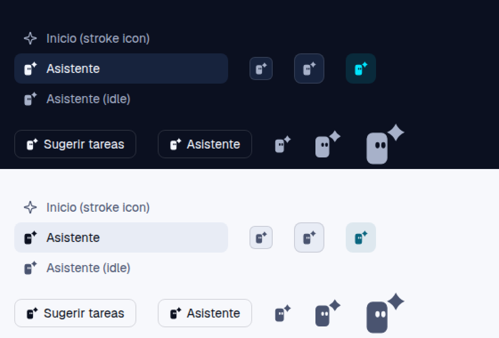

# Plan: Claudio, the assistant's mascot, and its recent conversations

Status: **designed, ready to launch** (2026-10-19). The owner chose the three decisions below on
2026-10-19 and answered the plan's open questions the same day ([The owner's answers](#the-owners-answers-2026-10-19)).
This plan settles the design: the drawing and its two marks, the page, the copy, the amendments to
the design system, the contract and the place of the mark across the app. The work is one pull
request on `feat/assistant-mascot`, built by the orchestration in [Tasks](#tasks). Workers run on
`claude-sonnet-5-5` and the review on `claude-opus-5-5`, never fable. Workers never run the e2e
suite: CI runs it (`pnpm e2e:remote`, the `e2e-on-github` skill).

This plan is the source of truth for that orchestration, together with CLAUDE.md and
CONTRIBUTING.md. Where a task prompt and this plan disagree, the plan wins. The drawings are already
committed as reference SVGs. A worker ports them; it does not redraw them.


## The owner's answers (2026-10-19)

1. **The mascot is called Claudio**, not "Cursor" (that name was dropped: it is also a well-known AI
   code editor's). Identifiers follow the name:
   - the illustration is `claudio`;
   - the marks are `ClaudioMascot` (colour) and `ClaudioGlyph` (one colour, for icon slots);
   - the reference files are `illustrations/claudio.svg`, `claudio-mark.svg` and `claudio-glyph.svg`.

   UI copy may say the name, so the greeting now reads "Hola, soy Claudio" ([Copy](#copy)).
2. **The gradient budget is accepted as on New chat.** The drawing's one gradient element belongs to
   the drawing and is not one of the screen's two surfaces. §4 says so in amendment 3.
3. **The mark replaces the sparkle everywhere the assistant appears.** That covers the Claudio
   assistant's chat greeting, the sidebar item, the More row, the command palette and the project
   assistant. Every place is listed with file:line in [Where the mark goes](#where-the-mark-goes) and
   assigned to a task.

## Context

Each fact below was re-read at `671350a4d` (main, 2026-10-19).

### The entry today

- `/assistant` is `ClaudioAssistant` in `apps/web/src/pages/claudio-assistant/Entry.tsx:32-118`. The
  order is `Hello` (`:84`), then the composer on a desktop (`:86`), then `.as-starters-section`
  (`:87-110`). On a phone the composer sits at the foot (`:114`).
- `Hello` (`:155-182`) draws three things:
  - `AssistantMark`, the lucide `Sparkle` on a neutral 40 px tile
    (`apps/web/src/components/assistant/run.tsx:23-29`);
  - the title and one line;
  - the live figures, from `useOverview()` and `useUsageNow()`: chats working and orchestrations
    running in `--live`, and today's cost.

  Its styles are in `apps/web/src/styles/claudio-assistant.css:21-71`.
- The composer is New chat's `StartComposer`. Its card is `form.composer.new-composer.grad-border` and
  its start button is `.btn.btn-primary.new-start` (`packages/chat-ui/src/composer/Composer.tsx:573`).
  That makes two gradient surfaces already. `docs/design-system.md:1664` still says "one gradient
  surface, the send button", which has been out of date since the 2026-10-17 switch to New chat's box.
- `e2e/specs/assistant.spec.mjs:75-100` checks `.as-hello` < the composer < `.as-starters-section`,
  that `.live-energy` counts 0, and the `grad-border` card. `apps/web/test/claudio-assistant.test.tsx:65`
  checks the same order in markup, and `:48` checks the greeting's words, which are also listed in
  `apps/web/test/fixtures/strings.json:2349-2350`.
- The assistant's system prompt opens with "You are the Claudio assistant"
  (`packages/core/src/claudio-assistant-prompt.ts:31`), and `packages/core/test/claudio-assistant-chat.test.ts:78`
  checks that line.

### The sparkle today

The lucide `Sparkle` stands for the assistant, both the Claudio assistant and the project assistant,
in every place listed in [Where the mark goes](#where-the-mark-goes). Those slots are typed
`LucideIcon` in three places: `NavItem.icon` (`apps/web/src/components/shell/nav.ts:10`), the
palette's entries, and `MenuItem.icon` (`packages/ui/src/components/controls/Menu.tsx:11`). The shared
`AssistantMark` tile turns cyan inside a live run (`apps/web/src/styles/suggestion.css:39-43`).

### The rules this changes

- `docs/design-system.md:1659`: "The entry screen is content, not an `Empty`." The live figures are
  part of that bullet.
- `docs/design-system.md:2103-2105` (§4): an illustration appears at most once per screen, never next
  to live data, and never as decorative filler on a page that has content.
- `docs/claudio-assistant.md:50`: "there is no illustration".
- The design system counts a drawn logo as a gradient surface (`docs/design-system.md:1901`, the setup
  assistant). New chat already draws `welcome` beside a `.grad-text` hero, the `grad-border` card and
  its primary (`apps/web/src/pages/NewChat.tsx:210-212`). `welcome` has one `f-grad` element and a halo.

### The logo and its tokens

- The source is `docs/design-system/claudio-brand-kit/logos/svg/claudio-symbol.svg`. It has three
  parts:
  - the open C, with a gradient `#246BFD` → `#A78BFA` (`x1 .35 y1 0 x2 .6 y2 1`, a stop at .5);
  - the four-point spark at its centre;
  - the prompt block, `rect x98 y51.5 11×17 rx3`, at its mouth.
- In the app it is `BrandMark` (`packages/ui/src/components/icons.tsx:34-54`), coloured by
  `.logo-mark .logo-stop-a/-b/.logo-spark` (`packages/ui/src/styles/primitives.css:721-731`).
- The tokens are `--logo-blue`, `--logo-violet` and `--logo-spark` (`packages/ui/src/styles/tokens.css:46-48`).
  `--logo-spark` turns `#246bfd` in light (`:293`, and `:375` for `system`). The comment at `:44-45`
  says the spark is "the one static cyan in the app".
- The brand guide (`docs/design-system/claudio-brand-kit/docs/BRAND-GUIDE.md`) forbids stretching or
  rotating the mark, outlining it and relying on glow. It allows single-colour versions.

### Illustrations

- `Illustration` (`packages/ui/src/components/illustrations/Illustration.tsx`) draws the frame first:
  one gradient (`--il-grad`, `--accent` → `--accent-2nd`), the dot pattern and the fade mask, all with
  `useId()` ids. Then it draws the drawing. The catalogue is the `ILLUSTRATIONS` map.
- Colour comes only from classes in `packages/ui/src/styles/illustrations.css`. Every loop stops under
  `data-motion='subtle' | 'off'` and `prefers-reduced-motion`, and `motion.css` pauses them in a
  hidden tab.
- `apps/web/test/illustrations.test.tsx:16` asserts 17 drawings, and `:35` asserts 12 ids for three
  instances.

### Chats and the assistant marker

- An assistant chat carries `claudioAssistant: ClaudioAssistantMarker`
  (`packages/shared/src/types.ts:1366,1382-1387`), and `ChatSummary` keeps it (`:1418`). The core sets
  it from the runtime record (`packages/core/src/chat-service.ts:435`).
- `GET /chats` (`apps/api/src/routes/chats.ts:93-104`) filters by `project`, `loose`, `origin`,
  `workers`, `state` and `limit`. It has no assistant filter.
  - The core's `ChatFilter` (`chat-service.ts:241-253`) and `list()` (`:462-483`) skip a chat before
    assembling it.
  - The web calls the route through `api.chats` (`apps/web/src/api.ts:600-611`).
  - The route is documented in `apps/api/src/openapi/routes.ts:328` and `docs/rest-api.md:550`.
- An assistant chat runs in its project's directory when it has one (`packages/core/src/index.ts:2063`),
  so the Chats page's project scope can hide some of them.
- The Chats page reads its filters from the address (`LIST_PARAMS`, `apps/web/src/pages/Chats.tsx:68`)
  into `ChatFilters` (`packages/chat-ui/src/lib/chat-model.ts:103-115`).
- Its `StateWord` (`Chats.tsx:106-116`) says working in `--live`, waiting in `--idle`, a bad outcome
  as a badge, and idle to screen readers only. The words come from `STATE_LABEL` (`chat-model.ts:44`):
  "Trabajando", "Esperándote", "Inactivo".

### The reference screens are stale

The screenshots `DesktopAsistenteClaudio-*.webp` and `MobileAsistenteClaudio-*.webp` in
`docs/design-system/reference/screenshots/` still show three things that changed:
- "Agentry" in the sidebar and the title;
- the live figures in mono;
- uppercase section labels.

`docs/design-system/reference/tools/assistant_entry.py` drew them. The project assistant's references
(`ai.py`, `desktop.py`, `phone.py`, `projects.py`) draw the sparkle through `ico("sparkle")`.

## Decisions

### D1. Claudio, a character derived from the logo

The logo's prompt block becomes a small character, Claudio. It is a rounded block in `--logo-spark`,
with the logo block's proportions (11 : 17, corners about a third of its width) and two dot eyes. It
peeks over the lower arm of the open C, which is its doorway. The four-point spark floats above its
head as "the idea", inside the C where the logo keeps it. A small prompt card (`›` and a blinking
caret) floats outside the mouth, because it is about to answer.

The C is the logo's own path, scaled uniformly by 1.1. It is not stretched, rotated, outlined or
given a glow, and it keeps the logo's gradient (`--logo-blue` → `--logo-violet`, the kit's direction
and stops). The gradient is on the C alone: the character, the spark and the card are flat. The
drawing has **no `.halo`**.

Two variants with hands were rejected (`assistant-mascot/variants-hands.png`). Hands gripping the
arm's edge read as feet or glasses at 160 px. A half-moon version disappears into the arm in light.
The plain peek (A) reads at every size.


### D2. Claudio is always on `/assistant`, and the live figures go

The illustration replaces the sparkle tile in `Hello` and shows in every state of the page. The
greeting no longer shows chats working, orchestrations running or today's cost. Home, the status bar
and the sidebar's live group already say them.

### D3. Recent assistant conversations under the starters

"Recientes" lists 5 rows on a desktop and 3 on a phone. Each row has the title (the first prompt), the
state as a word and the time since the chat's last activity. **Ver todas** leads to the Chats page
filtered to the assistant's chats. A new filter, `GET /chats?assistant=1`, feeds the list.

### D4. The mark everywhere the assistant appears, in two forms

The owner's answer 3. One character, two drawings:

- **`ClaudioMascot`** is the colour mark (`illustrations/claudio-mark.svg`, 24 × 24): the block, its
  eyes looking up and the spark, in `--logo-spark`, with eyes in `--bg`. It reads from 20 px. It is used
  where the assistant **speaks**: the first message of a Claudio assistant chat.
- **`ClaudioGlyph`** is the one-colour glyph (`illustrations/claudio-glyph.svg`, 16 × 16): the same
  block, with the eyes cut out (`fill-rule="evenodd"`) and the spark, all in `currentColor`. It is used
  in **icon slots** at 14 and 16 px: nav items, palette entries, menu items, buttons and the run tile.
  - It takes the slot's colour, as the stroke icons beside it do, so the sidebar shows no static cyan
    and a live run's tile still turns it `--live`.
  - It is a `forwardRef` component typed as `LucideIcon` (it takes `LucideProps` and ignores
    `strokeWidth`), so `NavItem`, the palette and `MenuItem` need no type change.
  - It is the brand guide's single-colour version of the character.




The project assistant takes the same character, because the owner wants one assistant face across
the app. Its runs keep their neutral tile (`AssistantMark`) with the glyph inside, so a live run
still turns cyan and a finished one goes still.

### D5. The gradient budget on `/assistant`

The owner's answer 2. The page has three brand-gradient elements:
- the composer's `grad-border` hairline and Enviar, one card and its primary, which is the pair §2
  allows (`design-system.md:492`);
- the C of the drawing, which is the drawing's own element, as `welcome`'s is on New chat. It is not
  counted, never takes a halo, and the page then has no `.grad-text`.

## Design

### The illustration `claudio` (240 × 160)

The reference is `docs/design-system/illustrations/claudio.svg`. Like the other reference SVGs, it
has its own `<style>` with dark fallbacks, the shared defs and the faded dot backdrop.

| Element | Geometry (user units) | Class | Colour |
|---|---|---|---|
| ground | ellipse `cx94 cy141 rx54 ry5` | `ln-soft` | `--line-2` |
| body | rect `x83 y74 32×54 rx9`, in `g.a-float` | `f-spark` (new) | `--logo-spark` |
| eyes | ellipses `cx100.5/109.5 cy90 rx2.6 ry3.6`, in `g.a-look` (new) | `f-eye` (new) | `--bg` |
| the C | the logo's path, `transform="translate(31 14) scale(1.1)"`, drawn **after** the body so its lower arm hides the body's foot | `f-logo cut` (new) | the logo gradient, over a 3-unit `--bg` stroke (`paint-order: stroke`) that separates it from the body |
| spark | the logo's spark recentred, `translate(97 59) scale(.4)`, in `g.a-float-2` | `f-spark` | `--logo-spark` |
| prompt card | rect `x146 y56 48×26 rx13`, `›`, and a caret rect `x168 y63 7×12`, in `g.a-float-2` | `c2`, `txt-big`, `f-ink a-blink` | `--bg-3`, `--line-3`, `--fg-3` |

These classes are new in `styles/illustrations.css`, and the same go into `claudio-ds.css` §14:

```css
.il .f-spark { fill: var(--logo-spark); }
.il .f-eye { fill: var(--bg); }
.il .f-logo { fill: var(--il-logo); }
.il .cut { stroke: var(--bg); stroke-width: 3; stroke-linejoin: round; paint-order: stroke; }
.il .stop-logo-a { stop-color: var(--logo-blue); }
.il .stop-logo-b { stop-color: var(--logo-violet); }
.il .a-look { transform-box: fill-box; transform-origin: center; animation: il-look var(--il-look-cycle) ease-in-out infinite; }
@keyframes il-look { 0%, 92%, 100% { transform: scaleY(1); } 95% { transform: scaleY(0.12); } }
```

- `Illustration.tsx` gains a fifth def, `${id}-logo`: a `linearGradient x1 .35 y1 0 x2 .6 y2 1` with
  stops at 0 and .5 (`stop-logo-a`) and at 1 (`stop-logo-b`). `--il-logo: url(#${id}-logo)` joins
  `--il-grad` and `--il-dots` on the root's style. Every drawing gets the def, so the id test goes from
  12 to 15.
- `--il-look-cycle: 6000ms` joins the `--il-*-cycle` tokens (`tokens.css:183-189`).
- `.cut` and `.f-eye` paint with the page's `--bg`. The drawing belongs on the page's own background,
  never on a raised card, where the cut would show as a ring.
- In light, `--logo-spark` is the same blue as the top of the C. The `.cut` gap is what tells them
  apart.

**Motion**, only under `data-motion='full'`. The existing `.il *` rules stop all of it under
`subtle`, `off`, `prefers-reduced-motion` and in a hidden tab.
- The body bobs 4 px (`a-float`, 4.8 s), which looks like peeking over the arm.
- The spark and the card float out of phase (`a-float-2`).
- The caret blinks (`a-blink`).
- The eyes blink once every 6 s (`a-look`).

Nothing pulses and nothing uses `--live`. `motion.spec.mjs` covers it as an `.il`.

### The two marks

| | `ClaudioMascot` | `ClaudioGlyph` |
|---|---|---|
| Reference | `illustrations/claudio-mark.svg` | `illustrations/claudio-glyph.svg` |
| viewBox | `0 0 24 24`: body `x2.5 y6.5 12.5×17 rx3.5`, eyes `cx9.3/12.5 cy12.2 rx1.2 ry1.65`, spark at `(19.2, 5)` scale .235 | `0 0 16 16`: body `x1.5 y3.75 7.75×11.75 rx2.25` with the eyes as evenodd holes (`cx5.55/7.75 cy8.4 rx.8 ry1.15`), spark at `(12.4, 3.6)` scale .174 |
| Colour | `.mascot-mark .mascot-body, .mascot-spark { fill: var(--logo-spark) }`, `.mascot-eye { fill: var(--bg) }` | `fill: currentColor`, so it takes the slot's colour |
| Sizes | 24 (≥ 20) | 14 (`ICON_SM`) and 16 (`ICON`); larger only inside a tile |
| Component | `ClaudioMascot({ size = 24 })` in `packages/ui/src/components/icons.tsx`, beside `BrandMark`; `aria-hidden`, still | `export const ClaudioGlyph: LucideIcon = forwardRef<SVGSVGElement, Omit<LucideProps, 'ref'>>(…)` in the same file; honours `size`, `className` and `aria-hidden`, and ignores `strokeWidth` |
| CSS | `.mascot-mark` block in `packages/ui/src/styles/primitives.css`, next to `.logo-mark` | none |

### Where the mark goes

Every place where the assistant appears, at `671350a4d`.

**Claudio assistant**

| Place | File:line | Now | Becomes | Task |
|---|---|---|---|---|
| The chat's first message | `apps/web/src/pages/claudio-assistant/Greeting.tsx:12` | `AssistantMark small` | `ClaudioMascot size={24}` | `entry-web` |
| The entry's greeting | `apps/web/src/pages/claudio-assistant/Entry.tsx:168` | `AssistantMark` | the `claudio` illustration | `entry-web` |
| Sidebar item and the More row | `apps/web/src/App.tsx:248` (one `NavItem`, used by the sidebar at `:277` and by the More sheet at `:471`); the comment at `:247` changes with it | `Sparkle` | `ClaudioGlyph` | `mark-everywhere` |
| Palette, "Asistente de Claudio" | `apps/web/src/components/CommandPalette.tsx:173` | `Sparkle` | `ClaudioGlyph` | `mark-everywhere` |

**Project assistant**

| Place | File:line | Now | Becomes | Task |
|---|---|---|---|---|
| Palette, the project's assistant (action) | `apps/web/src/components/CommandPalette.tsx:175` | `Sparkle` | `ClaudioGlyph` | `mark-everywhere` |
| Palette, the assistant per project | `apps/web/src/components/CommandPalette.tsx:231` | `Sparkle` | `ClaudioGlyph` | `mark-everywhere` |
| Project header button "Asistente" | `apps/web/src/pages/home/ProjectHead.tsx:75` | `Sparkle` | `ClaudioGlyph` | `mark-everywhere` |
| Project page's assistant row (phone) | `apps/web/src/pages/home/ProjectHead.tsx:130` | `Sparkle` in `.project-tab-cell-icon.is-accent` | `ClaudioGlyph` | `mark-everywhere` |
| The "⋯" sheet entry | `apps/web/src/pages/home/ProjectHead.tsx:147` | `Sparkle` | `ClaudioGlyph` | `mark-everywhere` |
| The run tile `AssistantMark` | `apps/web/src/components/assistant/run.tsx:23-29` (import at `:2`) | `Sparkle` in `.suggestion-mark` | `ClaudioGlyph` in the same tile; live still turns it cyan | `mark-everywhere` |
| … which reaches | `run.tsx:169`, `pages/assistant/cards.tsx:75,225`, `pages/home/resources/parts.tsx:167`, `pages/home/resources/ProposalEditor.tsx:144`, `pages/home/resources/CreateWithAI.tsx:156,230`, `pages/tasks/suggest/SuggestTasks.tsx:251` | through the component | nothing to edit at the call sites | `mark-everywhere` |
| "Start the assistant" (empty project) | `apps/web/src/pages/assistant/cards.tsx:27` | `Sparkle` | `ClaudioGlyph` | `mark-everywhere` |
| "Proponer" | `apps/web/src/pages/assistant/cards.tsx:211` | `Sparkle` | `ClaudioGlyph` | `mark-everywhere` |
| "Sugerir tareas" (icon and button) | `apps/web/src/pages/tasks/toolbar/TasksHeader.tsx:69,75` | `Sparkle` | `ClaudioGlyph` | `mark-everywhere` |
| The suggest dialog's start | `apps/web/src/pages/tasks/suggest/SuggestTasks.tsx:145` (the `RefreshCw` branch stays) | `Sparkle` | `ClaudioGlyph` | `mark-everywhere` |
| "Proponer equipo" | `apps/web/src/pages/team/Members.tsx:274,337`, `apps/web/src/pages/team/Team.tsx:78` | `Sparkle` | `ClaudioGlyph` | `mark-everywhere` |
| Resources, "Sugerir" | `apps/web/src/pages/home/ProjectResources.tsx:110` (the spinner branch stays) | `Sparkle` | `ClaudioGlyph` | `mark-everywhere` |
| Resources, "Crear con IA" | `apps/web/src/pages/home/resources/CreateWithAI.tsx:189` | `Sparkle` | `ClaudioGlyph` | `mark-everywhere` |
| Resources, the proposals group's head | `apps/web/src/pages/home/resources/nav.tsx:70` | `Sparkle` | `ClaudioGlyph` | `mark-everywhere` |

**Kept, because they are not the assistant**

- The "why" spark of a change: `components/changes/FileReview.tsx:260` and `components/changes/steps/StepsLens.tsx:264`.
- The `Sparkles` of other features' agent actions. Each runs its own chat, not the assistant:
  - `components/changes/ReviewComposer.tsx:72,91`
  - `components/OrchestrationChecks.tsx:265`
  - `pages/tasks/item/AddressReview.tsx:172,331`
  - `pages/tasks/item/Checks.tsx:170,338`
  - `pages/team/evals/DraftCases.tsx:112`
  - `pages/documents/Tied.tsx:114`
  - `pages/config/ConnectorsSection.tsx:140`
  - `pages/accounts/ModelFallbacksCard.tsx:115`

`mark-everywhere` re-greps `Sparkle\b` and `AssistantMark` before it starts and adds any new place
that stands for the assistant.

### The page on a desktop


These are static mock-ups built from the real tokens and the reference SVGs, at 1440 × 1024, the
reference size. They are not the app: the shell, the composer and the starters' icons are
approximated.

- `.as-body` keeps its 740 px column. Its `padding-top` goes from 56 to 28, so that at 1280 × 720 the
  composer and both rows of starters stay above the fold.
- `.as-hello` is **centred**, like New chat's hero:
  - `<Illustration name="claudio" size="md" />` (240 × 160);
  - the title (`--fs-title`, `--fw-strong`);
  - the line (`--fs-section`, `--fg-2`);
  - a 10 px gap between them.

  The class stays, so the e2e order check holds. `.as-figures` and its CSS go.
- The composer and `.as-starters-section` (2 × 2) do not change.
- `.as-recents-section` (new) comes last.
  - Its head is a row: `h2.section-label` "Recientes" on the left, and on the right the link **Ver
    todas** (`--fs-small`, `--accent`, `aria-label` "Ver todas las conversaciones con el asistente").
  - Under it is a list (`ul`, no card) of up to 5 `.as-recent` rows. Each row is a `Link` to
    `/chats/:id`, 40 px high, with a `--border` hairline between rows and above the first. Hover is
    `--bg-hover`, with no weight change.
  - Each row reads left to right:
    - the title, `displayTitle(chat)` from `@claudio/shared`, `--fs-body` regular, one line with an
      ellipsis (`min-width: 0`);
    - the state word (`.as-recent-word`, `--fs-small`);
    - the time, `timeAgo(chat.updatedAt)` from `packages/ui/src/lib/format.ts`, on the shared
      `useMinute()` tick: `--fs-small`, `--text-faint`, tabular, right-aligned in a 72 px minimum.
- **State words** are the Chats list's, without its motion. A colour always sits on its word:
  - `chatBusy(chat)` shows `STATE_LABEL.working` in `--live`;
  - `waiting` shows `STATE_LABEL.waiting` in `--idle`;
  - a bad outcome shows the Chats list's outcome word (`chats:list.outcome.*`) in `--bad`, as a word,
    not a badge;
  - idle shows nothing visible, and "Inactivo" goes to screen readers, as on Chats.

  There is no `ActivityTicker`, spinner, live rail or pulse.

### The page on a phone


- Under the `PhoneHeader`, in order:
  - the illustration, `size="sm"` (160 × 107), centred;
  - the title (`--fs-title`) and the line (`--fs-body`);
  - the starters: 3 in one column, `min-height: var(--touch)`;
  - the recents: **3** rows.

  The composer stays at the foot, as today.
- A recent row is two lines and 56 px high (≥ 44): the title first, then the word and the time,
  separated by ` · ` in `--text-faint`. **Ver todas** has a 44 px target through its padding.
- The four tabs stay, and Más is lit. Its first row, Asistente, now shows the glyph.

### States

| State | What shows |
|---|---|
| No assistant chat yet | No recents section at all: Claudio already greets, and an empty list would be a second empty state. |
| Loading (first read) | Nothing under the starters. It is the last section, so nothing above it moves when it arrives. No skeleton. |
| Some | 1 to 5 rows (3 on a phone), newest first, and Ver todas. |
| Error | The heading, one line `.as-recents-error` in `--fg-3` ("No se han podido cargar las conversaciones recientes"), and a `btn btn-ghost btn-sm` **Reintentar** that refetches. No `ErrorBox`, no illustration. |
| A chat starts working while the page is open | Its word turns to "Trabajando" when the list is refetched: the query is invalidated with the other `['chats', …]` queries on chat events. Nothing moves. |

The illustration and the greeting look the same in every state.

### Copy

In `apps/web/src/i18n/locales/{en,es}/assistant.json`, under `claudio`:

| Key | en | es |
|---|---|---|
| `hello` (changed) | Hi, I'm Claudio | Hola, soy Claudio |
| `sub` (changed) | Your assistant. I can tell you how your projects, tasks, orchestrations and usage are doing. | Tu asistente. Te cuento cómo van tus proyectos, tareas, orquestaciones y el uso. |
| `greeting` (changed) | Hi, I'm Claudio, your assistant. Ask me about your projects, tasks, orchestrations or usage. | Hola, soy Claudio, tu asistente. Pregúntame por tus proyectos, tareas, orquestaciones o el uso. |
| `recent.title` | Recent | Recientes |
| `recent.all` | See all | Ver todas |
| `recent.allLabel` | See all conversations with the assistant | Ver todas las conversaciones con el asistente |
| `recent.error` | The recent conversations could not load | No se han podido cargar las conversaciones recientes |
| `recent.retry` | Retry | Reintentar |

- The removed keys are `figures`, `chatsWorking_one/_other`, `orchestrations_one/_other` and `today`,
  in both languages.
- The nav label stays "Asistente" / "Assistant", and the palette's "Asistente de Claudio" stays too.
- On the Chats page (`chats.json`), the filter chip is `list.filter.assistant`: "From the assistant" /
  "Del asistente".
- The Spanish follows `apps/web/src/i18n/GLOSSARY.md`: Spain's Spanish, infinitive buttons
  ("Reintentar", glossary line 137), sentence case, and "No se han podido …" for a failure.
- So that the model answers as the greeting introduces it, the system prompt's first sentence
  (`claudio-assistant-prompt.ts:31`) becomes "You are Claudio, the assistant built into the Claudio
  app, an expert in it and the person's guide to it." The rest of the sentence stays.

### The Chats page, filtered

**Ver todas** links to `/chats?assistant=1`.
- `assistant` joins `LIST_PARAMS` (`Chats.tsx:68`), and `ChatFilters` gains `assistant: boolean`.
- `matchesFilters` keeps `chat.claudioAssistant != null`. The page already loads every chat, so it
  filters on the client.
- While the filter is on, a removable chip "Del asistente" shows in the `ListToolbar`, like the other
  filters.
- The page keeps its own project scope. The recents on `/assistant` are unscoped, because the
  assistant is global. With a project selected in the top bar, Chats may list fewer, and its scope
  chip says why.

### The design-system amendments

1. **§2, "The Claudio assistant", the entry-screen bullet** (`design-system.md:1659-1666`) is replaced
   by:

   > - **The entry screen is content, with its mascot.** At the top, centred, is the `claudio`
   >   illustration (`md`, `sm` on a phone): Claudio, the logo's prompt block, peeking out of the C. It
   >   is always there, in every state of the page, because it is the assistant's face, not an empty
   >   state. Under it come the greeting ("Hola, soy Claudio", `--fs-title`) and one line saying what
   >   the assistant does. Then come the composer (New chat's `StartComposer`, unchanged), "Para
   >   empezar" with the starters, and "Recientes". Recientes lists up to five of the assistant's own
   >   chats (three on a phone), each with its title, its state as a word and the time, and **Ver
   >   todas** opens Chats filtered to them. The page shows no live figures: what is running is on Home
   >   and in the status bar. A recent row never moves. There is no spinner, ticker or rail, only the
   >   word in its status colour. The gradient is on the composer's hairline, on Enviar, and on the
   >   drawing's C, which is the drawing's own element (§4). There is no halo and no `.grad-text`. The
   >   composer is not energy-bordered.

   The "Where it lives" bullet's sparkle sentences become: "The assistant's mark is Claudio. In the
   nav, the palette and on the Más row it is `ClaudioGlyph`, in the slot's own colour. It is never
   the gradient, so the entry costs no gradient slot on any screen."

   In the section's table:
   - the `.as-figures` row goes;
   - `.as-hello` reads "the greeting block, centred: the `claudio` illustration, the title and the line";
   - new rows: `.as-recents-section`, `.as-recent` (`-word` with `.is-live`, `.is-idle`, `.is-bad`)
     and `.as-recents-error`;
   - `.as-greeting` reads "`ClaudioMascot` at 24 px and one dimmed line";
   - `.cell > .ai-mark` reads "`ClaudioGlyph` on the Más row".

2. **§2, "Assistant, suggestions and resources with AI"** (`design-system.md:425-461`): wherever it
   says sparkle for the project assistant (its tile `.ai-mark`/`.suggestion-mark` and its buttons), it
   now says `ClaudioGlyph`. The tile and its live cyan stay.

3. **§4, the catalogue and its rules.**
   - The count goes from 17 to 18, with a new row:

     > | `claudio` | the Claudio assistant's entry (`/assistant`), always. Claudio, the logo's prompt block, peeks out of the C, with the spark above its head and a prompt card at the mouth. It is the one illustration with the logo's own gradient (`f-logo`) and its spark colour (`f-spark`) | accent |

   - Under "How they are built in the app", add: "`f-logo` paints with the logo's gradient (`--il-logo`,
     `--logo-blue` → `--logo-violet` in the kit's direction), and `f-spark` with `--logo-spark`. Only a
     drawing derived from the logo uses them." List `look` (the eyes' blink, 6 s) with the motions.
   - The rules become:

     > - At most one per screen.
     > - Never next to live data, and never decorative filler on a page that has content, **except
     >   the assistant's entry**. There the `claudio` drawing is the assistant's identity and is shown
     >   always. That page keeps the rule's intent: it shows no live figures, and the state words of
     >   its recents stand still.
     > - **An illustration's one gradient element is part of the drawing** (New chat's `welcome`, the
     >   assistant's C). It does not count as one of the screen's two gradient surfaces (§2,
     >   "Gradients"). It takes a halo only where the screen has no other gradient surface, so
     >   `claudio` never has one.

   - A short "Claudio's marks" paragraph after the catalogue describes `ClaudioMascot` (colour, ≥ 20 px,
     where the assistant speaks) and `ClaudioGlyph` (one colour, icon slots), with their reference
     files.

4. **§1, Brand.** The comment on `--logo-spark` (`tokens.css:44-45`) and its line in §1 say "the spark
   and Claudio, the assistant's mascot, are the one static cyan in the app". The glyph is never cyan
   unless its slot is live.

5. **`docs/claudio-assistant.md:50`.** "The box's hairline is the screen's gradient surface; there is
   no illustration." becomes: "Above the greeting is Claudio, the `claudio` illustration
   ([plans/assistant-mascot.md](plans/assistant-mascot.md)). Under the starters, the assistant's recent
   chats link to Chats filtered to them." The "optional live figures" in the bullet's first sentence go,
   and the sparkle in "Sidebar" becomes Claudio's glyph.

6. **`docs/design-system.md:1664`.** Its stale "The page has one gradient surface, the send button"
   goes, because amendment 1 replaces it.

### Catalogue and references

- `docs/design-system/illustrations/claudio.svg`, `claudio-mark.svg` and `claudio-glyph.svg` are
  committed with this plan.
- In `docs/design-system/claudio-ds.css`:
  - §14 (`:425`) gains the classes above and a `.mascot-mark` block;
  - in the §2 assistant block (`:2185-2191`), `.as-figures` goes, `.as-hello` is centred, and
    `.as-recents-section`, `.as-recent`, `-word` and `.as-recents-error` are added.
- `docs/design-system/reference/DSIlustraciones.html` gains a tile for `claudio` after `welcome`, and a
  row of the two marks.
- In the reference tools, `common.py`'s `ico()` gains a `claudio` glyph (the path of
  `claudio-glyph.svg`, `fill="currentColor"`). `ico("sparkle")` becomes `ico("claudio")` wherever it
  stands for the assistant: `assistant_entry.py:24` and its nav item, `ai.py:22,356,444,506,605`, and
  the assistant's nav items, header buttons and Más rows in `desktop.py`, `phone.py` and `projects.py`.
  The `references` task greps those files. The "why" sparks in `checks.py`, `decision_parts.py` and
  `reviews.py` stay.
- `assistant_entry.py` is redrawn for the new entry (the illustration, no figures, sentence-case
  labels, the recents, "Hola, soy Claudio") and the greeting's colour mark. Then every screen whose
  generator changed is regenerated, HTML and `-dark`/`-light` `.webp` screenshots, through the tools'
  `shoot.py`. That covers at least:
  - `DesktopAsistenteClaudio`, `DesktopAsistenteClaudioChat`, `MobileAsistenteClaudio`,
    `MobileAsistenteClaudioChat` and `MobileAsistenteClaudioMas` (which stops saying Agentry);
  - the project assistant's `DesktopAsistente*` and `MobileAsistente*`;
  - every screen whose sidebar shows the Asistente item.

## Contracts

### `GET /chats?assistant=1`

| | |
|---|---|
| Query | `assistant`: `1` keeps only chats that carry `claudioAssistant`. Any other value is a 400, `assistant must be 1`. Absent means no filter, as today. |
| Combines with | every other parameter. `/assistant` asks `?assistant=1&limit=5`. The default origins (`claudio,external`) include assistant chats. |
| Answer | `ChatSummary[]`, newest first, as today. |
| Core | `ChatFilter.assistant?: boolean` (`chat-service.ts:241`). In `list()`, `if (filter.assistant && !runtime?.claudioAssistant) continue;` runs before `assemble`. |
| Shared types | none. The query is not a type in `packages/shared/src/types.ts`, and `ChatSummary` already carries `claudioAssistant`. `pnpm --filter @claudio/api openapi:schemas` is still run and must not drift. |
| Web | `api.chats` (`apps/web/src/api.ts:600`) gains `assistant: filter.assistant ? '1' : undefined`, and the web `ChatFilter` gains `assistant?: boolean`. |
| OpenAPI | In `apps/api/src/openapi/routes.ts:328`, the querystring gains `assistant: str('`1` for the chats of the Claudio assistant only', { enum: ['1'] })`, and the description gains one sentence. The summary and tag stay. |
| `docs/rest-api.md:550` | The path becomes ``/chats?project=&loose=1&origin=&workers=0&state=&assistant=1&limit=``, and the text ends "…; `assistant=1` keeps only the Claudio assistant's chats". |
| Token | as `GET /chats` today. |

Follow the `add-rest-route` skill: route, OpenAPI, the doc row, tests.

A chat whose runtime record is gone has no marker and is not listed. It also loses its greeting today,
so this is not a new gap.

## Tasks

The integrator launches this graph on `feat/assistant-mascot`. Every worker runs on
`claude-sonnet-5-5`; only `review` runs on `claude-opus-5-5`. Never fable. **Four stages**:
`core-api · mascot-art → entry-web · mark-everywhere → references → review · docs`.

| Id | Model | Task | dependsOn | Owns | Checks |
| --- | --- | --- | --- | --- | --- |
| `core-api` | sonnet | The `assistant=1` filter (core, route, OpenAPI, doc row, web `api.chats`), and the system prompt's first sentence | – | `packages/core/src/chat-service.ts` (`ChatFilter`, `list`), `packages/core/src/claudio-assistant-prompt.ts:31`, `packages/core/test/claudio-assistant-chat.test.ts:78`, `apps/api/src/routes/chats.ts:93-104`, `apps/api/src/openapi/routes.ts` (`GET /chats` only), `docs/rest-api.md:550`, `apps/web/src/api.ts` (`chats` and its `ChatFilter` only), new tests in `packages/core/test` and `apps/api/test` | `pnpm typecheck`; `pnpm test` (core, api, the docs rows test); `pnpm --filter @claudio/api openapi:schemas` with no drift |
| `mascot-art` | sonnet | Port the three reference SVGs: `claudio.tsx` and its registry entry, the logo def, the new classes and `a-look`, `--il-look-cycle`, `ClaudioMascot`, `ClaudioGlyph`, `.mascot-mark`; §1 Brand, §4 and the catalogue | – | `packages/ui/src/components/illustrations/{claudio.tsx (new),Illustration.tsx,index.ts}`, `packages/ui/src/styles/illustrations.css`, `packages/ui/src/styles/tokens.css` (`--il-look-cycle` and the `--logo-spark` comment only), `packages/ui/src/components/icons.tsx` (`ClaudioMascot`, `ClaudioGlyph` only), `packages/ui/src/styles/primitives.css` (`.mascot-mark`, beside `.logo-mark`), `apps/web/test/illustrations.test.tsx`, a new `apps/web/test/claudio-marks.test.tsx`, `docs/design-system.md` §1 Brand and §4, `docs/design-system/claudio-ds.css` §14, `docs/design-system/reference/DSIlustraciones.html` | `pnpm typecheck`; `pnpm test` (web: 18 illustrations, 15 ids, design-tokens, design-voice, the new marks test); `node scripts/design-lint.mjs` on the edited CSS; a render of `DSIlustraciones` in both themes compared with `docs/plans/assistant-mascot/{mascot-*,mark,glyph}.png` |
| `entry-web` | sonnet | The page: `Hello` with the illustration and no figures, the recents and their states, the greeting's `ClaudioMascot`, the new copy, the Chats `assistant` filter, the e2e spec, §2 "The Claudio assistant" | `core-api`, `mascot-art` | `apps/web/src/pages/claudio-assistant/{Entry.tsx,Greeting.tsx,Recents.tsx (new)}`, `apps/web/src/styles/claudio-assistant.css`, `apps/web/src/pages/Chats.tsx` (the `assistant` param, its chip, and the state-word helper factored out of `StateWord`), `packages/chat-ui/src/lib/chat-model.ts` (`ChatFilters`, `matchesFilters`), `apps/web/src/i18n/locales/{en,es}/{assistant,chats}.json`, `apps/web/test/claudio-assistant.test.tsx`, `apps/web/test/fixtures/{class-names,strings}.json` (regenerated), `e2e/specs/assistant.spec.mjs`, `docs/design-system.md` §2 "The Claudio assistant" (`:1647-1694`, `:1664` included), `docs/design-system/claudio-ds.css` §2 assistant block (`:2185-2191`) | `pnpm typecheck`; `pnpm test` (web, chat-ui); design lint; `/ui-review /assistant`; screenshots at 1280×720, 1440×1024 and 390×844 in both themes compared with `docs/plans/assistant-mascot/entry-*.png`. **Writes the e2e checks and never runs them** |
| `mark-everywhere` | sonnet | Every place in "Where the mark goes" that belongs to `mark-everywhere`: the nav item (sidebar and Más), the palette's three entries, the project header, row and sheet entry, `AssistantMark`'s glyph, and the project assistant's buttons; §2 "Assistant, suggestions and resources with AI" | `mascot-art` | `apps/web/src/App.tsx:247-248`, `apps/web/src/components/CommandPalette.tsx:173,175,231` (and its `Sparkle` import), `apps/web/src/pages/home/ProjectHead.tsx:75,130,147`, `apps/web/src/components/assistant/run.tsx:2,23-29`, `apps/web/src/pages/assistant/cards.tsx:27,211`, `apps/web/src/pages/tasks/toolbar/TasksHeader.tsx:69,75`, `apps/web/src/pages/tasks/suggest/SuggestTasks.tsx:145`, `apps/web/src/pages/team/Members.tsx:274,337`, `apps/web/src/pages/team/Team.tsx:78`, `apps/web/src/pages/home/ProjectResources.tsx:110`, `apps/web/src/pages/home/resources/CreateWithAI.tsx:189`, `apps/web/src/pages/home/resources/nav.tsx:70`, `apps/web/test/fixtures/bundle-shape.json` (only if its test asks), `docs/design-system.md` §2 "Assistant, suggestions and resources with AI" (`:425-461`) and the "Where it lives" bullet of §2 "The Claudio assistant" (one sentence, after `entry-web`'s edit: rebase onto it) | `pnpm typecheck`; `pnpm test` (web); design lint on edited files; `/ui-review` of the sidebar, `/projects/:id` (header and phone row), `/projects/:id/assistant` (live and finished run) and the palette, at 1280×720 and 390×844, both themes. Updates `e2e/specs/suggest.spec.mjs:70`'s comment if it names the sparkle; never runs e2e |
| `references` | sonnet | The reference tools and screens: the `claudio` glyph in `ico()`, `assistant_entry.py` redrawn, `ico("sparkle")` → `ico("claudio")` where it is the assistant, and every changed screen regenerated, HTML and screenshots | `entry-web`, `mark-everywhere` | `docs/design-system/reference/tools/{common,assistant_entry,ai,desktop,phone,projects}.py`, the regenerated `docs/design-system/reference/*.html` and `reference/screenshots/*.webp` of those generators | the tools' `lint.py` and `check.mjs` as `tools/README.md` describes; `python3 voice.py` stays idempotent; open `DesktopAsistenteClaudio` and `MobileAsistenteClaudio` in both themes and compare them with the entry mock-ups |
| `review` | **opus** | Review the merged result against this plan | `core-api`, `mascot-art`, `entry-web`, `mark-everywhere`, `references` | none: findings only, or one-line fixes in places no one owns | reads; at most one test run |
| `docs` | sonnet | The feature doc, status, this plan's Status and Outcome | `core-api`, `mascot-art`, `entry-web`, `mark-everywhere`, `references` | `docs/claudio-assistant.md` (`:50`, the entry and sidebar bullets), `docs/assistant.md` (the mark, one sentence), `docs/status.md`, this plan's Status and Outcome | `pnpm test` (the docs tests) |

On overlaps:
- `mascot-art`, `entry-web` and `mark-everywhere` each edit `docs/design-system.md` and `claudio-ds.css`
  in different sections.
- `mark-everywhere` touches one sentence of `entry-web`'s §2 section, so it rebases onto `entry-web`
  before it commits that sentence.
- `entry-web` owns `Entry.tsx` and `Greeting.tsx`, so `mark-everywhere` never edits them.

### Rules for every task

1. Work only in your worktree, on your branch. Write Conventional Commits in English, with a body that
   says why. Never push.
2. Read CLAUDE.md and CONTRIBUTING.md first. TypeScript strict, no `any`, `noUncheckedIndexedAccess`.
3. Run `pnpm typecheck` and `pnpm test`. Write or update e2e specs, but **never run `pnpm e2e`**, and
   never set `E2E_ALLOW_LOCAL`.
4. UI tasks load the `claudio-ui` skill and pass `/ui-review` before finishing. No hex, `rgb()`, pixel
   radius or millisecond value outside `tokens.css`.
5. Port the reference SVGs exactly, with the same geometry and classes. Their `<style>` blocks and
   fallbacks stay out of the app.

### `entry-web`, details

- In `Hello`, drop `useOverview`, `useUsageNow`, `formatCost` and the `AssistantMark` import.
- `Recents` (`pages/claudio-assistant/Recents.tsx`):
  - `useQuery` with key `['chats', { assistant: true, limit: 5 }]` and `api.chats({ assistant: true, limit: 5 })`;
  - shows `narrow ? 3 : 5` rows;
  - renders nothing while `isPending` or when the list is empty.
- Factor the state word out of `Chats.tsx`'s `StateWord` into a helper that returns
  `{ word, tone: 'live' | 'idle' | 'bad' } | null`. Chats keeps its ticker and badge, and the recents
  draw the plain word.
- e2e (`assistant.spec.mjs`):
  - At the entry, `.as-hello .il[data-illustration="claudio"]` exists, `.as-figures` does not, and
    `.live-energy` is still 0. Keep the order check.
  - After the spec starts a chat and comes back to `/assistant`:
    - `.as-recents-section` follows `.as-starters-section`;
    - its first `.as-recent` links to that chat's `/chats/:id`;
    - **Ver todas** goes to `/chats?assistant=1`, where the "From the assistant" chip shows.
  - The chat's `.as-greeting` holds `.mascot-mark`.

### `mark-everywhere`, details

- Each listed `Sparkle` becomes `ClaudioGlyph`, with the same props (`{...ICON_SM}`, `{...ICON}`, or
  `icon: ClaudioGlyph`). Remove the `Sparkle` imports that become unused.
- In `AssistantMark`, keep the tile, its classes and the live cyan. Only the glyph changes. Its doc
  comment says "Claudio's glyph on a neutral tile".
- The phone's assistant row in `ProjectHead.tsx:130` keeps `.project-tab-cell-icon.is-accent`. The
  glyph takes the accent like the stroke icon did.

### `review` (opus)

Review the merged design, not just the diff:
- the drawing against `claudio.svg` in both themes, with the `.cut` gap visible in light;
- the marks against `claudio-mark.svg` and `claudio-glyph.svg` at 14, 16 and 24 px;
- every row of [Where the mark goes](#where-the-mark-goes) done, and nothing in the "kept" list changed;
- motion stops under `subtle`, `off`, reduced motion and in a hidden tab;
- the gradient count as D5 states it, with no halo;
- no live figure left, and no motion on a recent row;
- every status colour on its word;
- the copy against the glossary, and "Claudio" spelled the brand's way;
- `assistant=1` validated and documented;
- the references regenerated;
- the e2e checks written and plausible.

Findings go to the integrator, with file:line and the smallest fix.

## Tests

- **core**:
  - `list({ assistant: true })` returns only chats whose runtime carries `claudioAssistant`, combines
    with `limit` and `project`, and skips the others before `assemble`;
  - the system prompt starts "You are Claudio, the assistant built into the Claudio app".
- **api**: `GET /chats?assistant=1` answers only the marked chat, `?assistant=2` is a 400, and leaving
  it out changes nothing.
- **web** (`illustrations.test.tsx`): 18 drawings; `claudio` renders without hex or `<style>`; three
  instances have 15 unique ids, and every `url(#…)` resolves.
- **web** (`claudio-marks.test.tsx`, new):
  - `ClaudioMascot` renders `aria-hidden` with the three classes and no hex;
  - `ClaudioGlyph` renders `fill="currentColor"`, honours `size` and `className`, and is accepted where
    a `LucideIcon` is typed (a `NavItem` literal compiles).
- **web** (`claudio-assistant.test.tsx`):
  - the order is hello (with `data-illustration="claudio"`) < composer < starters < recents;
  - no `.as-figures`;
  - the greeting reads "Hola, soy Claudio" / "Hi, I'm Claudio";
  - a recent row shows the word for working, waiting and failed, and none for idle;
  - an empty list renders no section, and the error state renders Reintentar.
- **chat-ui**: `matchesFilters` with `assistant: true`.
- **docs**: the `docs/rest-api.md` row test.
- **e2e**, written by `entry-web` and run by CI through `pnpm e2e:remote assistant motion suggest mobile`:
  the checks above. `motion.spec.mjs` must stay green.

## Risks

- **Cyan that does not mean live.** The colour mascot is `--logo-spark`, the same cyan as `--live` in
  dark.
  - It is the brand's own exception (amendment 4), it never moves like live work, and it appears only
    on `/assistant` and in the chat greeting.
  - Icon slots use the one-colour glyph, so the sidebar and the run tiles keep cyan for live only.
- **The cut ring.** `.cut` and the eyes paint with `--bg`. On another surface they would show a ring,
  so the drawing stays on page backgrounds.
- **A filled glyph among stroke icons.** At 14 to 16 px, `ClaudioGlyph` is the one filled shape in a
  stroke set, which is on purpose (it is a character, not an action). It is drawn at the same optical
  size as the lucide icons. The renders in `glyph.png` show it beside one.
- **Brand drift.** A character built from the mark invites new poses. This plan allows only a uniform
  scale of the C and no recolouring. New poses need a plan.
- **Recents and scope.** Recents are global and Chats is scoped, so "Ver todas" can show fewer under a
  project scope. The scope chip explains it.
- **Missing markers.** A chat whose runtime record was lost is not an assistant chat any more. This
  predates the plan.

## Open questions

None. The owner answered all three on 2026-10-19 ([The owner's answers](#the-owners-answers-2026-10-19)).

## Related

[[claudio-assistant]] · [[plans/claudio-assistant-entry]] · [[plans/claudio-assistant]] · [[design-system]] · [[assistant]] · [[plans/claudio-designer]] · [[rest-api]] · [[plans/container-polish]]
